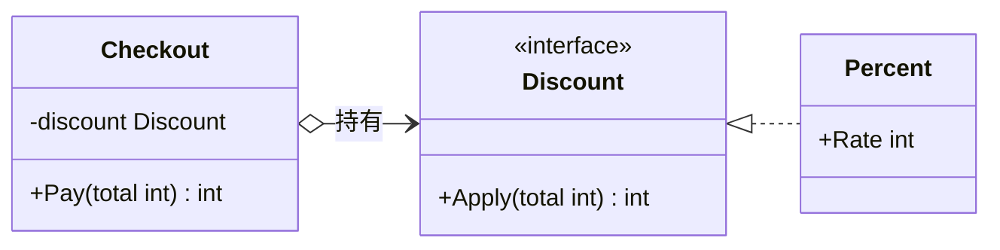

# 附录 D &nbsp; 怎么读类图

## 一个方框是一个类型

各章的类图用 [Mermaid](https://mermaid.js.org/) 画，沿用 UML 类图的写法。下图取自[第 13 章](../behavioral/strategy/problem.md)：

Checkout 持有 Discount 接口，Percent 实现了这个接口

| 方框里的写法 | 含义 | 对应的 Go |
|---|---|---|
| 第一行 `Checkout` | 类型名 | `type Checkout struct{...}` |
| `<<interface>>` | 这是接口 | `type Discount interface{...}` |
| `<<函数>>` | 这是普通函数，不是类型；Go 里常用函数代替只有一个方法的类型 | `func LoginForm(t Theme) string` |
| `+Rate int`、`-discount Discount` | 字段：名字在前，类型在后 | 结构体字段 |
| `+Pay(total int) int` | 方法：参数和返回值照 Go 签名写 | 方法 |
| `+` / `-` | 导出 / 未导出 | 首字母大写 / 小写 |

方框只列跟本模式有关的成员，不是完整定义；完整代码看每章 N.2 节。

## 连线看关系

本书只用到下面 4 种线。箭头都**从「知道对方的一边」指向「被知道的一边」**。

| 线 | 名称 | 读作 | 对应的 Go | 例子 |
|---|---|---|---|---|
| `A <\|.. B`（虚线 + 空心三角） | 实现 | B 实现了接口 A | B 拥有 A 要求的全部方法，不用写 `implements` | [策略](../behavioral/strategy/problem.md)：`Percent` 实现 `Discount` |
| `A o--> B`（实线 + 空心菱形） | 聚合 | A 持有 B，B 由外部传入，可单独存在、可替换 | A 的字段类型是 B 或 `[]B` | [观察者](../behavioral/observer/problem.md)：`Shop` 持有一组 `Observer` |
| `A --> B`（实线箭头） | 关联 | A 长期知道 B，会调用它 | 通常是 A 的字段 | [外观](../structural/facade/problem.md)：`HomeTheater` 调各个设备 |
| `A ..> B`（虚线箭头） | 依赖 | A 只在某次调用中用到 B | B 出现在参数、返回值或函数体里 | [迭代器](../behavioral/iterator/problem.md)：`Playlist` 创建 `Iterator` |

线上的文字（如「持有」「委托操作」）说明这条关系在本例中具体做什么。

!!! tip "为什么没有继承线"

    UML 用实线 + 空心三角（`<|--`）表示继承。Go 没有继承，书里的「可替换」全部靠接口实现，所以只会看到虚线三角。

## 三步读懂一张类图

1. **先找 `<<interface>>`**：接口就是模式里「可以替换」的那一点。
2. **再看虚线三角**：指向接口的有几个类型，就有几种可替换的实现；新增一种，就是多画一个方框。
3. **最后看谁持有接口**：持有接口的一方（上例的 `Checkout`）只认接口，换实现时它不用改。这通常就是该模式要保护的代码。
