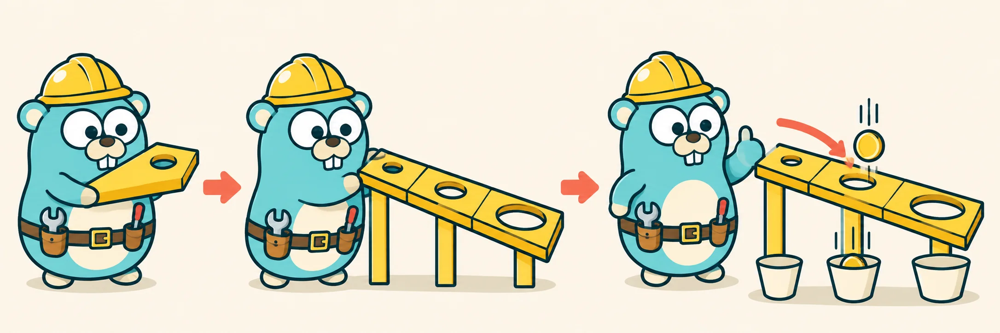

# 17.2 Go 实现

## 三步写完

**第 1 步**：请求和统一接口。链上每一环都只需要实现 `Handle`。

```go
--8<-- "codes/behavioral/chain/chain.go:handler"
```

**第 2 步**：具体处理者。额度内就批；批不了，有下一环就交出去，没有就说明到头了。

```go
--8<-- "codes/behavioral/chain/chain.go:approver"
```

**第 3 步**：把链串起来。从链尾往前建，最后返回链头。

```go
--8<-- "codes/behavioral/chain/chain.go:chain"
```

{ .illus }

<p class="caption">从高到低按孔径由小到大拼接；中号硬币越过小孔，在中孔停下</p>

!!! tip "改规则只改串链的地方"

    加一级「副总」、调整额度、让某个部门跳过经理，只需修改 `NewChain` 中组装链的代码（不同部门也可组装不同的链），`Approver` 和调用方一行不改。

## 使用示例

```go
--8<-- "codes/behavioral/chain/example_test.go:example"
```

[:material-play: 在 Go Playground 运行](https://go.dev/play/p/ldpQGJKiK9h){ .md-button .md-button--primary target=_blank } [:material-github: 查看完整源码](https://github.com/caticat/design-pattern/tree/master/codes/behavioral/chain){ .md-button target=_blank }
