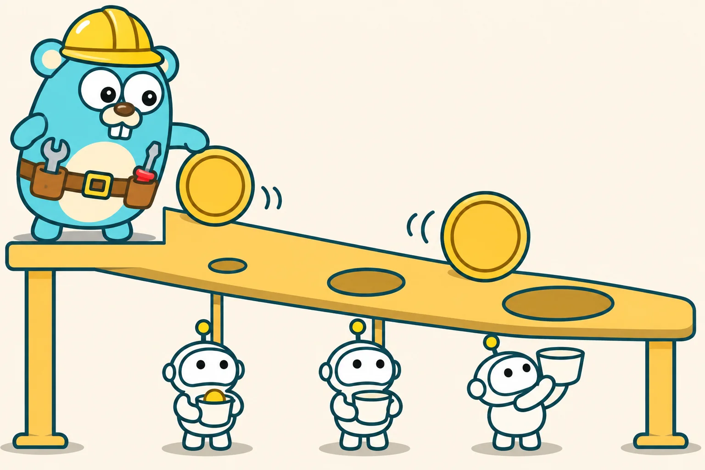

# 责任链模式

:material-shape-outline: 行为型
:material-signal-cellular-1: 难度 入门
:material-fire: 使用频率 中

{ .cover }

!!! abstract ""

    报销单按金额由组长、经理、总监分级审批。最直接的写法是一个函数里一串 `if-else` 判断该谁批，可审批人一变（加一级、调额度、换顺序），这个函数就得改。

    责任链模式把处理者**串成一条链**，请求从链头进去，每一环能处理就处理，处理不了就交给下一环。就像分币滑道：硬币一路往下滚，掉进第一个装得下它的孔。

## 本章内容

| 节 | 内容 |
|---|---|
| [17.1 问题与思路](problem.md) | 谁来处理写死在一个函数里，怎么改成沿链传递 |
| [17.2 Go 实现](implementation.md) | 统一接口、审批人、把链串起来 |
| [17.3 Go 里的责任链](stdlib.md) | 用函数切片串链、标准库中的例子、什么时候用 |
| [17.4 小结](summary.md) | 重点回顾、常见问题与动手试试 |

**前置知识**：[附录 D 怎么读类图](../../appendix/class-diagram.md)　**相关对比**：[对象之间传消息](../../compare.md#messaging)
