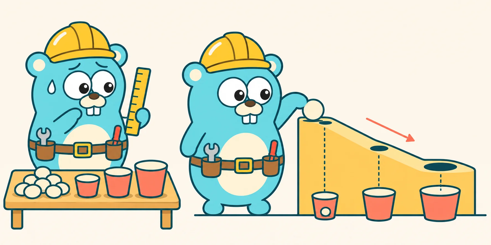
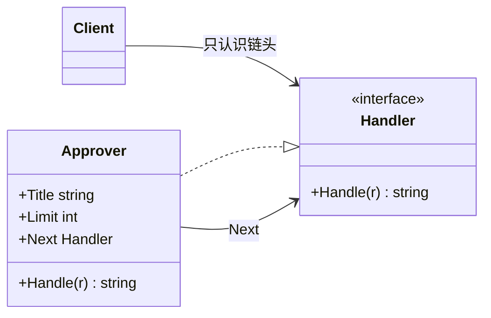

# 17.1 问题与思路

## 谁来处理，写死在一个函数里

报销单按金额分级审批：1000 元以内组长批，5000 以内经理批，50000 以内总监批。

{ .illus }

<p class="caption">每枚都要自己量、自己判断扔哪；交给滑道，硬币自己找到装得下它的孔</p>

最直觉的写法：一个函数从小到大挨个判断：

```go
--8<-- "codes/behavioral/chain/bad.go:bad"
```

| 痛点 | 后果 |
|---|---|
| 审批规则和顺序全挤在一个函数里 | 加一级「副总」、调一个额度，都要改这个函数 |
| 审批人不能单独复用、单独测试 | 另一个部门想跳过经理，只能复制一份再改 |

根本原因：**谁来处理、按什么顺序问，全写死在一个函数里**。

## 处理不了就往下传

1. 每个处理者实现同一个接口，并持有「下一个」，==处理不了就交给下一个==，自己不关心后面是谁。
2. 调用方只把请求交给链头；链怎么串（谁在前、谁在后）在创建时决定，随时可以调整。



<p class="caption">每个 Approver 都指向下一个 Handler，串成一条链</p>

| 角色 | 职责 | 本例中 |
|---|---|---|
| 处理者（Handler） | 定义处理请求的统一接口 | `Handler` |
| 具体处理者（ConcreteHandler） | 能处理就处理，否则转给下一个 | `Approver`（组长、经理、总监） |
| 客户端（Client） | 把请求交给链头 | 调用 `Handle` 的代码 |
