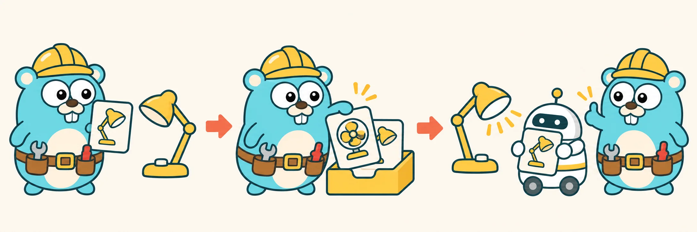

# 18.2 Go 实现

## 三步写完

**第 1 步**：定义命令接口。`LightOn` 记住目标台灯，执行时才开灯。

```go
--8<-- "codes/behavioral/command/command.go:command"
```

**第 2 步**：队列按顺序执行。`Run` 先取走当前批次，执行时新加的命令留给下一次。回调里再调用 `Run` 会直接返回，不会提前执行下一批。

```go
--8<-- "codes/behavioral/command/command.go:queue"
```

**第 3 步**：把目标设备和命令组装好，再交给队列。风扇用函数命令，写法见 [18.3](stdlib.md)。

{ .illus }

<p class="caption">填好目标与动作，交给队列，取出后才执行</p>

!!! tip "示例只在一个 goroutine 里使用"

    这里的 `Queue` 不支持并发调用，也不负责自动重试。

## 使用示例

```go
--8<-- "codes/behavioral/command/example_test.go:example"
```

[:material-play: 在 Go Playground 运行](https://go.dev/play/p/9MYA3oCm6Ti){ .md-button .md-button--primary target=_blank } [:material-github: 查看完整源码](https://github.com/caticat/design-pattern/tree/master/codes/behavioral/command){ .md-button target=_blank }
