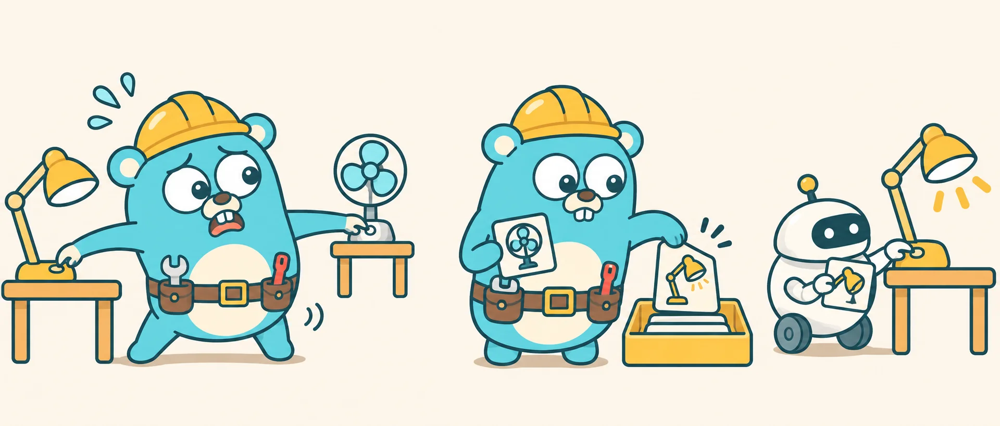
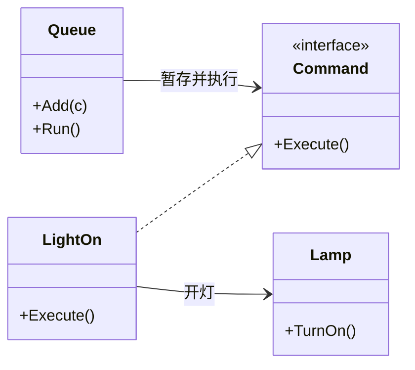

# 18.1 问题与思路

## 按下按钮就执行，想排队怎么办

工作台的面板可以开灯、启动风扇。现在想先按好按钮，准备就绪后再按顺序启动设备。

{ .illus }

<p class="caption">亲手按开关只能立刻执行；写成任务卡就能先排队，稍后执行</p>

最直觉的写法：面板收到按钮名称，直接调用设备：

```go
--8<-- "codes/behavioral/command/bad.go:bad"
```

| 痛点 | 后果 |
|---|---|
| 按钮分支写死设备操作 | 每加一种操作，面板就多一个分支 |
| 调用时就改变设备状态 | 要延后执行，就得另外存按钮名和目标，之后再分派一次 |

根本原因：**提交请求和执行操作写在一起**。

## 把操作装进任务卡

1. 命令绑定设备和动作；==提交方保存的是命令，不是执行结果==。
2. 队列只持有 `Command`，轮到哪条就调用它的 `Execute`，不用认识灯或风扇。



<p class="caption">队列只管何时运行；每条命令自己找到设备并执行相应操作</p>

| 角色 | 本例中 | 职责 |
|---|---|---|
| 调用者（Invoker） | `Queue` | 暂存并触发命令 |
| 命令（Command） | `Command`、`LightOn` | 提供统一入口，封装目标和动作 |
| 接收者（Receiver） | `Lamp` | 真正执行开灯 |
