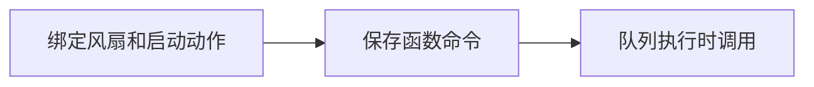

# 18.3 Go 里的命令

## 只有一个动作时，用函数就够了

如果命令只需要执行，不需要独立的字段或撤销方法，一个无参函数就能保存动作。给函数类型加上 `Execute`，它就能放进同一个队列：

```go
--8<-- "codes/behavioral/command/command.go:func"
```

`command.Func(fan.Start)` 把目标风扇绑定到操作里，还没有启动风扇。有额外参数时，可用[闭包](../../appendix/callbacks.md)把参数一起带上。



<p class="caption">创建函数值时不执行动作；队列调用时才启动风扇</p>

## 标准库里的类似用法

| 位置 | 保存了什么 | 何时执行 |
|---|---|---|
| `time.AfterFunc` | 一个 `func()` | 等待指定时长后，在自己的 goroutine 中调用 |
| `context.AfterFunc` | 一个 `func()` | 上下文取消后，在自己的 goroutine 中调用 |
| `os/exec.Cmd` | 程序路径、参数等执行配置 | 调用 `Start` 或 `Run` 时启动进程 |

## 什么时候用

<div class="grid" markdown>

!!! success "适合"

    - 请求要排队、定时或成批执行
    - 同一套按钮或队列要接收不同的操作
    - 需要记录操作历史，并为部分操作提供撤销

!!! failure "不适合"

    - 请求只需立即执行一次，直接调用已经够清楚
    - 动作要跨进程保存，却只打算传一个 Go 闭包

</div>
