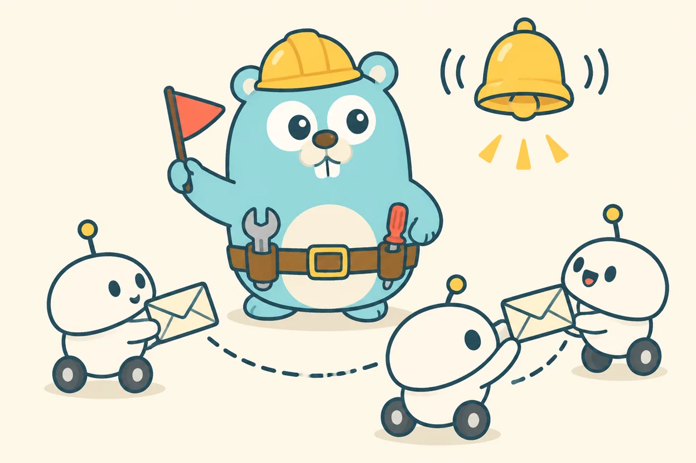

# 行为型模式

{ .cover }

关注**对象之间怎么协作**：如何分配职责、传递请求、响应变化。

| 章 | 模式 | 解决的问题 |
|---|---|---|
| 13 | [策略](strategy/index.md) | 同一件事有多种做法，需要随时切换 |
| 14 | [观察者](observer/index.md) | 一处变化，多处需要知道 |
| 15 | [模板方法](template-method/index.md) | 流程固定，个别步骤不同 |
| 16 | [迭代器](iterator/index.md) | 遍历集合又不想暴露内部结构 |
| 17 | [责任链](chain-of-responsibility/index.md) | 不确定谁来处理请求 |
| 18 | [命令](command/index.md) | 需要排队、撤销、记录请求 |
| 19 | [状态](state/index.md) | 行为随状态变化，`if/switch` 越写越多 |
| 20 | [备忘录](memento/index.md) | 需要撤销/恢复到之前的状态 |
| 21 | [中介者](mediator/index.md) | 对象之间关系网太乱 |
| 22 | [访问者](visitor/index.md) | 结构稳定，却要不断添加新操作 |
| 23 | [解释器](interpreter/index.md) | 规则要能在配置里改，与、或、非随意组合 |

容易混淆的两组：要排队或记录**做了什么**，看命令；要恢复**原来是什么**，看备忘录。要换同一件事的算法，看策略；行为由当前阶段决定，而且操作可能改变阶段，看状态。
