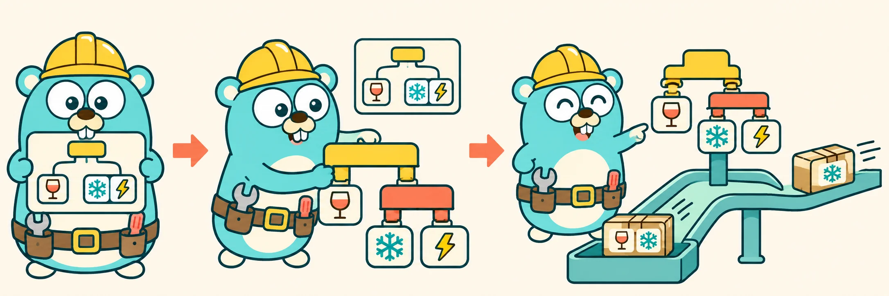

# 23.2 Go 实现

## 三步写完

四个小结构体加一个接口，就是整个模式。

{ .illus }

<p class="caption">规则卡只拼一次；换一个包裹时，积木不动，只换要检查的标签</p>

**第 1 步**：叶子。`Parcel` 是包裹的标签表；`tagExpr` 只查一个标签，没有就是 `false`（map 读不到的键返回零值）。

```go
--8<-- "codes/behavioral/interpreter/interpreter.go:leaves"
```

**第 2 步**：运算节点。每个节点持有孩子，`Eval` 时先问孩子再合并。末尾的 `Tag`、`Not`、`And`、`Or` 只是方便拼树的构造函数。

```go
--8<-- "codes/behavioral/interpreter/interpreter.go:operators"
```

**第 3 步**：拼树、求值。树拼一次，换包裹反复用。规则写在配置里时，`Parse` 把文字变成同样的树（怎么做见 [23.3](tradeoffs.md)）。

```go
--8<-- "codes/behavioral/interpreter/example_test.go:example"
```

[:material-play: 在 Go Playground 运行](https://go.dev/play/p/UZDjxcFZy-q){ .md-button .md-button--primary target=_blank } [:material-github: 查看完整源码](https://github.com/caticat/design-pattern/tree/master/codes/behavioral/interpreter){ .md-button target=_blank }

## 写法选择：结构体还是函数

节点只有 `Eval` 一个方法，所以也可以全用函数：`type Rule func(Parcel) bool`，`And` 返回 `func(p Parcel) bool { return a(p) && b(p) }`。代码更短，效果一样。

| 写法 | 适合 |
|---|---|
| 函数 | 只要求值，越短越好 |
| 结构体 | 还要打印规则、检查规则、序列化，需要知道节点里有什么 |

本章用结构体，是为了让「树」看得见；实际项目两种都常见。
