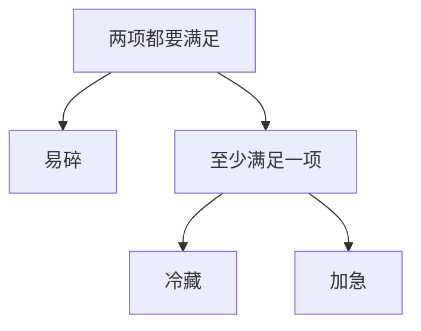
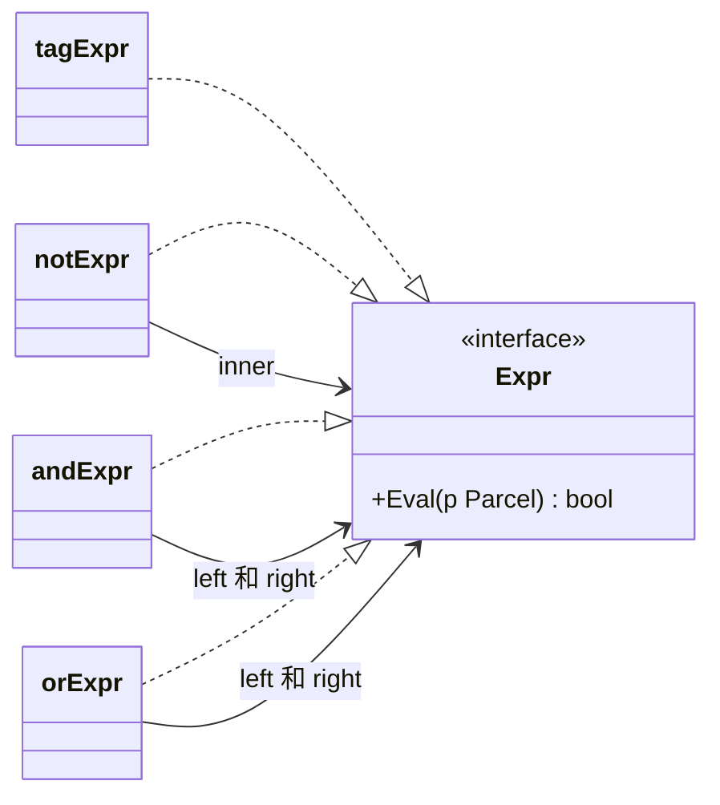

# 23.1 问题与思路

## 规则一变，就要改代码发版

分拣台按标签筛选包裹：`fragile` 是易碎，`cold` 是冷藏，`express` 是加急。上周的规则是「易碎且冷藏」，这周运营想改成「易碎，且冷藏或加急」，下周可能又变。

{ .illus }

<p class="caption">同一个易碎加急的包裹：旧规则要求冷藏，不放行；新规则允许冷藏或加急，因此放行。</p>

最直接的写法：规则就是一行 Go 代码。

```go
--8<-- "codes/behavioral/interpreter/bad.go:bad"
```

| 痛点 | 后果 |
|---|---|
| 改规则 | 改代码、测试、发版，运营自己改不了 |
| 规则放进配置 | 配置里只是一行文字，程序不知道 `&&`、括号是什么意思 |

根本原因：**规则是代码，不是数据**。要让规则能随时换，得把它变成程序能拿来算的数据。

## 把规则拼成一棵树

「易碎，且冷藏或加急」画出来就是一棵树：



<p class="caption">易碎加急：放行；只有加急：不放行。加急只满足右边的条件，左边的易碎条件也必须满足。</p>

说白了：==`&&`、`||`、`!` 各写成一个小结构体，都有 `Eval` 方法；规则就是它们拼成的树。== 叶子查一个标签；「与」节点问左右两个孩子，再把答案合起来。从根节点 `Eval`，一路问到叶子，答案就出来了。换规则只是换一棵树，代码不用改。



<p class="caption">孩子的类型也是 Expr，所以每个位置既能接一个标签，也能接一整条子规则</p>

| 角色 | 职责 | 本例中 |
|---|---|---|
| 表达式（Expression） | 所有节点共同的接口 | `Expr` |
| 终结符表达式（Terminal Expression） | 叶子：读一个数据 | `tagExpr` |
| 非终结符表达式（Nonterminal Expression） | 运算节点：合并孩子的结果 | `notExpr`、`andExpr`、`orExpr` |
| 上下文（Context） | 当前要判断的数据 | `Parcel` |

「解释器」和 Python 解释器是同一个意思：程序自己读懂规则并执行，只是这里的「语言」小到只有与、或、非。
