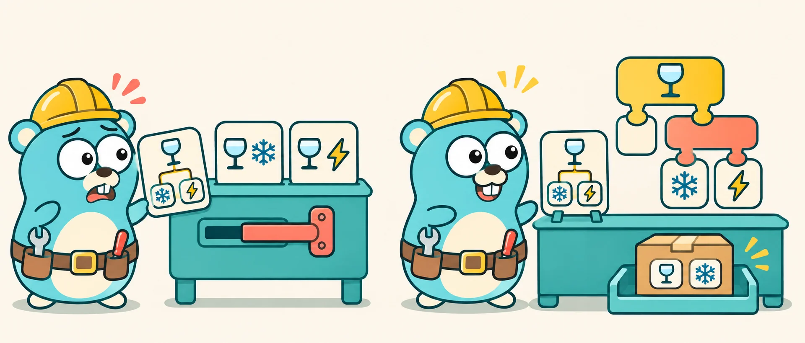
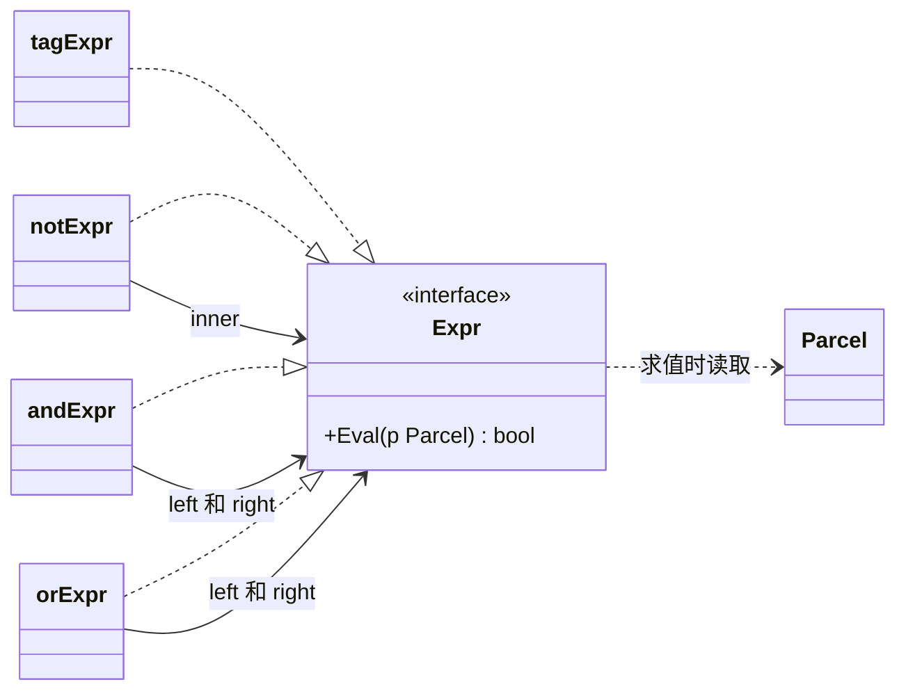

# 23.1 问题与思路

## 每条新规则都要改代码

分拣台按标签筛选包裹：`fragile` 是易碎，`cold` 是冷藏，`express` 是加急。运营此前分别用过「易碎且冷藏」和「易碎且加急」，现在想用一条规则表示「易碎，且冷藏或加急至少满足一个」。

{ .illus }

<p class="caption">分拣台不再只认登记过的整张规则卡，而能用已有积木拼出新规则</p>

最直接的办法是按规则原文写 `switch`：

```go
--8<-- "codes/behavioral/interpreter/bad.go:bad"
```

连去掉运算符两边的空格，含义没变，也会被当成一条未登记的规则。

## 让每个节点只懂一种规则

==把规则拆成可组合的表达式，每种节点只负责自己的判断。== 标签是叶子，「非」接一个子表达式，「与」「或」各接两个。新规则只要重新组装这些节点，不必新增一条分支。调用方把包裹交给根节点，根节点再按需让子节点判断。



<p class="caption">运算节点的子节点也是 Expr，所以每个位置都能接一个标签或一整条子规则</p>

| 角色 | 职责 | 本例中 |
|---|---|---|
| 表达式（Expression） | 约定如何求值 | `Expr` |
| 终结符表达式（Terminal Expression） | 读出单个标签的值 | `tagExpr` |
| 非终结符表达式（Nonterminal Expression） | 对子表达式求值并组合结果 | `notExpr`、`andExpr`、`orExpr` |
| 上下文（Context） | 提供当前要判断的数据 | `Parcel` |
| 客户端（Client） | 解析规则并调用根节点 | 分拣程序 |
