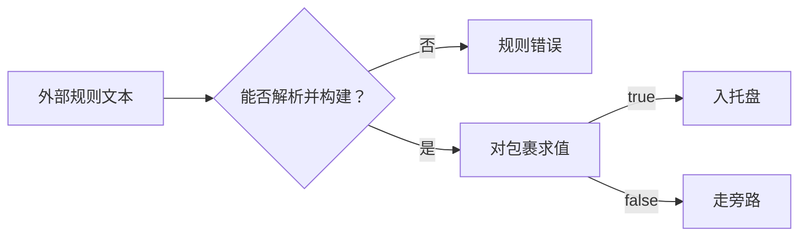

# 23.4 小结

## 重点回顾

!!! takeaway "划重点"
    - 文法规则对应表达式节点；叶子读数据，运算节点处理子规则。
    - 解析负责看懂文本，求值才使用包裹标签。两者分开，规则就能重复使用。
    - 先确定要支持哪些语法；不要把「解析器认得」当作「业务允许」。

规则写错要报告错误，不能当成包裹正常地不符合规则

## Q & A

**Q**：为什么不用 `strings.Split` 按 `&&` 或 `||` 切开？

切字符串不认识括号，也不知道先算「与」再算「或」。例如只有加急标签的包裹，`fragile && (cold || express)` 不通过，`fragile && cold || express` 却会通过。

**Q**：把 `fragile` 拼成 `fraglie`，为什么解析成功？

它仍是合法的标签名，只是在包裹里找不到。如果标签集合固定，可以在构建叶子时查允许名单，把拼写错误提前报出来，而不是等分拣结果异常。

**Q**：能直接用 Go 的语法树执行 Go 代码吗？

本例不能。语法树只是结构；`build` 只接受有限种节点，连 `cold()` 都会在解析规则时被拒绝。`true` 和 `false` 在本例也是标签名，不是布尔常量。

**Q**：解释器和组合模式有什么关系？

组合模式说明叶子和容器如何统一使用；解释器在相似的树结构上，再为每种节点规定文法和求值含义。

## 动手试试

1. **加一个「恰好一个」运算**：新增 `xorExpr`，`Eval` 返回左右结果不相等；在 `buildBinary` 里放行 `token.NEQ` 并构建它，让 `cold != express` 表示「冷藏、加急恰好一个」。

    提示：要改包内代码，克隆仓库后运行 `go test ./codes/behavioral/interpreter`。检验：只冷藏为 `true`，两者都有或都没有为 `false`；`tagExpr`、`notExpr`、`andExpr`、`orExpr` 一行没改，原有测试照常通过。

2. **什么样的标签名能用**：分别 `Parse` 规则 `易碎 && 冷藏`、`same-day && cold`、`range || cold`，打印错误或对 `{"易碎": true, "冷藏": true}` 的求值结果。

    提示：可直接在本章 Playground 里完成。检验：第一条得到 `true`（中文是合法的 Go 标识符）；第二条报「不支持的运算符：-」，被读成减法；第三条因 `range` 是 Go 关键字报语法错误。标签名受 Go 标识符规则约束。
