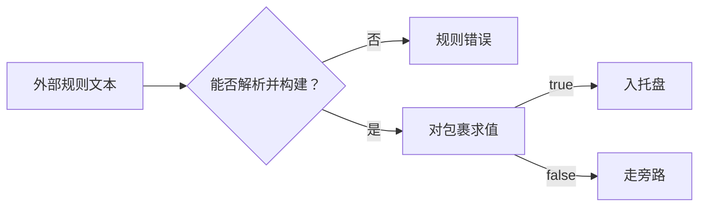

# 23.4 小结

## 重点回顾

!!! takeaway "划重点"
    - 解释器 = 把规则拼成**一棵小结构体树**：叶子读数据，与、或、非节点合并孩子的结果。
    - 规则从代码变成数据：可以从配置文字解析出来，解析一次、反复求值。
    - 规则要经常由别人改、组合又多时才用；几条固定判断直接写 `if`。

规则写错要报告错误，不能当成包裹正常地不符合规则

## Q & A

**Q**：为什么不用 `strings.Split` 按 `&&` 或 `||` 切开？

切字符串不认识括号，也不知道先算「与」再算「或」。例如只有加急标签的包裹，`fragile && (cold || express)` 不通过，`fragile && cold || express` 却会通过。

**Q**：把 `fragile` 拼成 `fraglie`，为什么解析成功？

它仍是合法的标签名，只是在包裹里找不到。如果标签集合固定，可以在构建叶子时查允许名单，把拼写错误提前报出来，而不是等分拣结果异常。

**Q**：用 Go 的解析器，会不会把配置当成 Go 代码执行？

不会。`build` 只翻译标签、括号和与或非，`cold()` 这样的函数调用在解析时就报错。

**Q**：解释器和组合模式有什么关系？

形状一样，都是一棵「孩子也是同一接口」的树。组合关心统一处理叶子和容器；解释器的每种节点代表一种运算，整棵树就是一条规则。

## 动手试试

1. **加一个「恰好一个」运算**：新增 `xorExpr`，`Eval` 返回左右结果不相等；在 `buildBinary` 里放行 `token.NEQ` 并构建它，让 `cold != express` 表示「冷藏、加急恰好一个」。

    提示：要改包内代码，克隆仓库后运行 `go test ./codes/behavioral/interpreter`。检验：只冷藏为 `true`，两者都有或都没有为 `false`；`tagExpr`、`notExpr`、`andExpr`、`orExpr` 一行没改，原有测试照常通过。

2. **易碎但不加急**：用 `And`、`Not`、`Tag` 拼出这条规则，对 `{"fragile": true}` 和 `{"fragile": true, "express": true}` 求值；再用 `Parse("fragile && !express")` 验证结果一样。

    提示：可直接在本章 Playground 里完成。检验：前者 `true`，后者 `false`，手拼和解析结果相同。

参考答案：[exercise_test.go](https://github.com/caticat/design-pattern/blob/master/codes/behavioral/interpreter/exercise_test.go)（练习 1 需改动包内代码，答案见提示）
