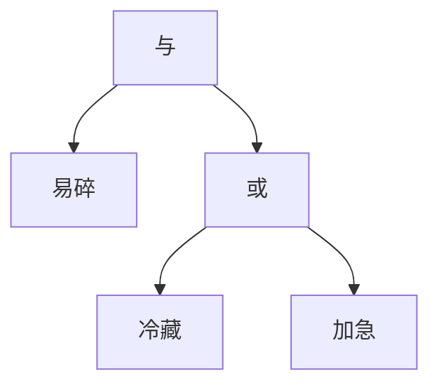

# 23.3 规则语言的边界

## 从参数表到小语言

只允许「这些标签都要有」时，用一张标签表配一个 `for` 循环即可。要让运营自行表达「两组任选一组」或「排除某组」，平铺字段就不够用了；表达式能把任意一组条件再当成一条子规则。



<p class="caption">「冷藏或加急」整体占据「与」的一个输入位置，加急不能绕过易碎条件</p>

## 解析后，只接收规定的节点

`go/parser.ParseExpr` 读出抽象语法树（Abstract Syntax Tree，AST）。`build` 只接收标签名、括号和本例定义的运算，不接收数字或函数调用。

```go
--8<-- "codes/behavioral/interpreter/interpreter.go:parse"
```

`buildBinary` 只接收「与」和「或」。即使运行时可能短路，解析阶段也要检查左右两边。

```go
--8<-- "codes/behavioral/interpreter/interpreter.go:binary"
```

`text/template` 也把解析和执行分开。`(*template.Template).Parse` 解析模板，其中条件分支在语法树中是 `text/template/parse.IfNode`。`(*template.Template).Execute` 用调用方给的数据执行模板，把结果写到 `io.Writer`。它把求值集中在执行器中，并不是每个节点自己实现一个 `Eval` 方法。

## 什么时候用

<div class="grid" markdown>

!!! success "适合"

    - 运算种类少而稳定，但组合多，并且要在配置中改动。
    - 规则相同、输入常变，适合解析一次后反复求值。

!!! failure "不适合"

    - 只有几条固定判断：直接写在 Go 代码里更容易读。
    - 语法越来越接近脚本语言：错误定位、类型检查和维护成本随之上升，优先评估现成方案。

</div>
