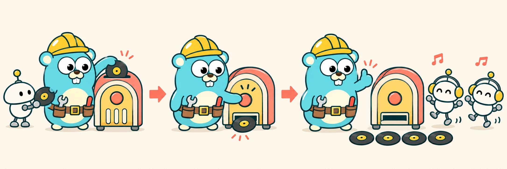

# 16.2 Go 实现

## 三步写完

**第 1 步**：集合。节点类型 `node` 不导出，外部只能用 `Add` 加歌。

```go
--8<-- "codes/behavioral/iterator/playlist.go:collection"
```

**第 2 步**：经典迭代器对象。用 `cur` 记住走到哪一首，`Next` 取出当前这首并前进一步。

```go
--8<-- "codes/behavioral/iterator/playlist.go:classic"
```

**第 3 步**：Go 1.23 的写法。`All` 返回一个函数，把每首歌交给 `yield`；`yield` 返回 `false` 说明调用方 `break` 了，要立刻停。

```go
--8<-- "codes/behavioral/iterator/playlist.go:seq"
```

{ .illus }

<p class="caption">歌放进去就不用管怎么存；按一下出一首；一首接一首，顺序不乱</p>

!!! tip "两种写法选哪个"

    新代码优先用 `iter.Seq`：调用方写普通的 `for range`，还能直接交给 `slices.Collect` 等标准库函数。经典迭代器适合需要「暂停、稍后继续」的场景，见 [16.3](stdlib.md)。

## 使用示例

```go
--8<-- "codes/behavioral/iterator/example_test.go:example"
```

[:material-play: 在 Go Playground 运行](https://go.dev/play/p/bHE7KQzC2r2){ .md-button .md-button--primary target=_blank } [:material-github: 查看完整源码](https://github.com/caticat/design-pattern/tree/master/codes/behavioral/iterator){ .md-button target=_blank }
