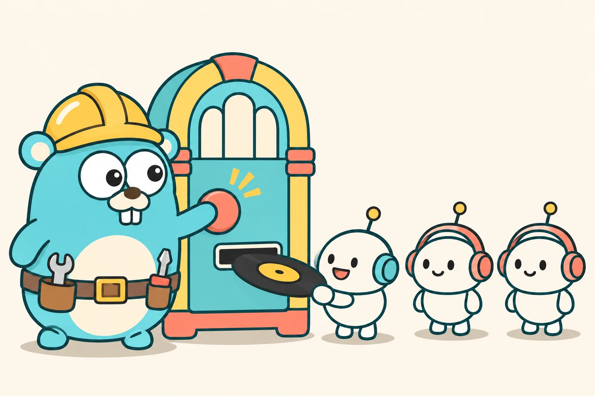

# 迭代器模式

:material-shape-outline: 行为型
:material-signal-cellular-1: 难度 入门
:material-fire: 使用频率 高

{ .cover }

!!! abstract ""

    播放列表内部用链表保存歌曲。为了让别人能逐首播放，最省事的办法是把链表节点直接暴露出去，可这样所有调用方都依赖了链表结构，哪天改成切片，每处遍历都要重写。

    迭代器模式让集合**自己提供遍历方式**，调用方只管「下一个」，就像点唱机：按一下按钮出一张唱片，不用打开机器看唱片怎么放。

## 本章内容

| 节 | 内容 |
|---|---|
| [16.1 问题与思路](problem.md) | 内部结构被迫暴露，怎么只给出「下一个」 |
| [16.2 Go 实现](implementation.md) | 经典迭代器对象、Go 1.23 的 `iter.Seq` |
| [16.3 Go 里的迭代器](stdlib.md) | 组合迭代器、标准库中的例子、什么时候用 |
| [16.4 小结](summary.md) | 重点回顾与常见问题 |
