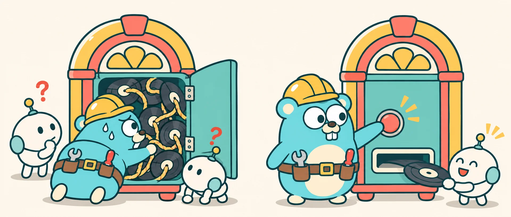
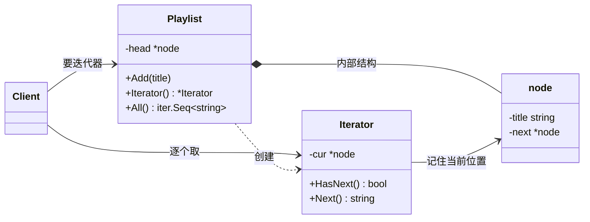

# 16.1 问题与思路

## 为了遍历，把内部结构交了出去

播放列表内部用链表保存歌曲，外部要能逐首播放。

{ .illus }

<p class="caption">想要下一张，就得钻进机器理清唱片怎么串；机器只留一个按钮，按一下出一张</p>

最直觉的写法：把链表节点导出，调用方自己沿着指针走：

```go
--8<-- "codes/behavioral/iterator/bad.go:bad"
```

| 痛点 | 后果 |
|---|---|
| 调用方依赖链表结构 | 播放列表改用切片保存，所有遍历的地方都要改 |
| 每处遍历都手写指针移动 | 代码重复，忘写 `n = n.Next` 就死循环 |

根本原因：**「怎么遍历」写在了集合外面**，集合的内部结构只好跟着暴露。

## 集合自己提供「下一个」

1. 节点不再导出，==遍历的代码写在集合内部==，调用方拿到的只有「下一首」。
2. 两种形式：经典的迭代器对象（`HasNext`、`Next`）；Go 1.23 起更常用 `iter.Seq`，调用方直接 `for range`。



<p class="caption">调用方只认识 Playlist 和 Iterator，看不到 node</p>

| 角色 | 职责 | 本例中 |
|---|---|---|
| 集合（Aggregate） | 保存元素，创建迭代器 | `Playlist` |
| 迭代器（Iterator） | 记住遍历位置，逐个给出元素 | `Iterator`、`All` 返回的函数 |
| 客户端（Client） | 通过迭代器遍历，不碰内部结构 | 调用方的 `for` 循环 |
