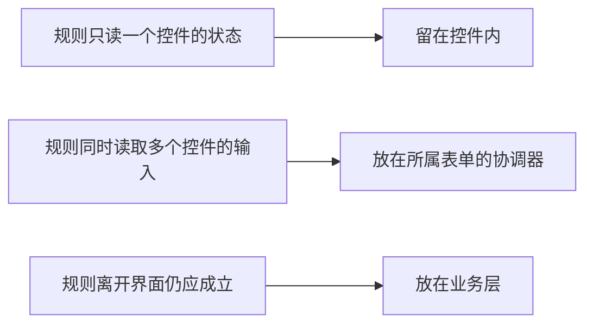

# 21.3 协调逻辑放在哪

## 先看谁拥有这条规则

按钮怎么显示禁用样式，是按钮自己的事；什么时候禁用，要同时看配送选项和地址，是表单的事。只把后者交给协调器。若业务还要校验地址是否真的能配送，也应交给相应的业务逻辑，而不是塞进这段界面联动代码。

根据规则所需的信息和作用范围，决定把它放在哪一层

| 写法 | 换来什么 | 要付出什么 |
|---|---|---|
| 控件直接调用 | 调用路径短，点进去就能看到下一步 | 一条规则跨多个控件时，容易各算各的 |
| 表单集中协调 | 在一处看全联动规则，便于测试输入组合 | 协调器认识参与者，规则越多越要管住职责 |

## 标准库里的相近做法

`net/http.ServeMux` 集中匹配请求和处理函数：用 `Handle` 或 `HandleFunc` 注册，`ServeHTTP` 选择并调用匹配的处理函数。这和中介者一样，把「接下来该交给谁」放在一处；它是请求路由器，不负责像本例那样根据几个控件的状态协调联动。

## 什么时候用

!!! success "适合"

    - 多个输入共同决定界面状态，单个控件拿不到完整信息
    - 联动规则经常一起变化，有明确的归属范围，例如一张表单

!!! failure "不适合"

    - 只有一条固定的直接调用，加一层只会转发
    - 想把互不相关的页面都塞进同一个协调器

