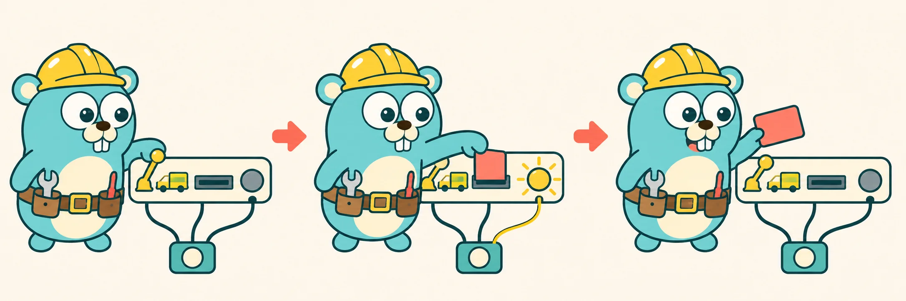

# 21.2 Go 实现

## 三步把表单接起来

{ .illus }

<p class="caption">切到配送时地址框出现；填入和清空地址都只改变提交状态，不隐藏地址框</p>

**第 1 步**：定义控件。开关和地址框只更新自己的输入，然后调用 `changed`。提交按钮不产生这类输入，只保存能否提交。

```go
--8<-- "codes/behavioral/mediator/mediator.go:widgets"
```

**第 2 步**：`NewCheckout` 给两个输入控件装上同一个回调 `c.refresh`，并刷新一次初始状态。每次回调都用当前的两项输入重新计算，不依赖「上一次是谁改的」。地址只含空白也不能提交。

```go
--8<-- "codes/behavioral/mediator/mediator.go:checkout"
```

**第 3 步**：只暴露设置配送选项、填写地址和读取状态的方法。调用方改完输入就能读取新状态，不必手动刷新。

```go
--8<-- "codes/behavioral/mediator/mediator.go:controls"
```

## 使用示例

示例先从自取切到配送，再填写、清空地址，最后切回自取。每次调用返回时，两个显示状态已经同步更新。

```go
--8<-- "codes/behavioral/mediator/example_test.go:example"
```

[:material-play: 在 Go Playground 运行](https://go.dev/play/p/A7KWVkC5aXP){ .md-button .md-button--primary target=_blank } [:material-github: 查看完整源码](https://github.com/caticat/design-pattern/tree/master/codes/behavioral/mediator){ .md-button target=_blank }
