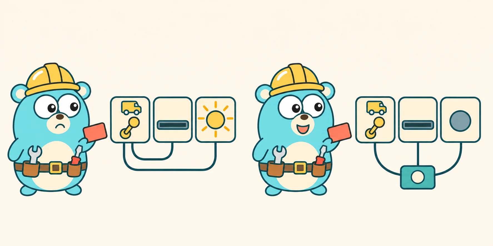
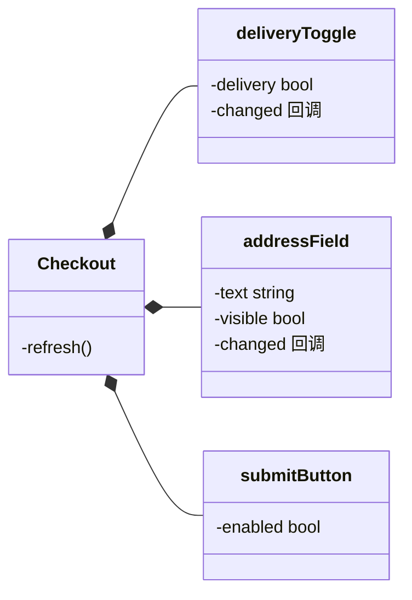

# 21.1 问题与思路

## 控件各管一部分，按钮状态就可能过期

结账表单有三样控件：配送开关、地址框、提交按钮。自取时隐藏地址框并允许提交；配送时显示地址框，填了非空白地址才允许提交。

{ .illus }

<p class="caption">清空地址也会改变能否提交，不能只在切换配送时更新按钮</p>

反例把规则写进配送开关。切到配送后，如果地址原本填好了，按钮就会亮；接着清空地址，地址框只存了新文本，没人关闭按钮。

```go
--8<-- "codes/behavioral/mediator/bad.go:bad"
```

让地址框也更新按钮能修掉这一处错误，却要在两个控件里各写一次提交规则。

## 让控件报告变化，不替彼此做决定

把==跨控件的规则放到协调器里==。开关和地址框只负责保存各自的输入，并通知协调器。协调器每次都读取当前选项和地址，统一刷新显示、提交状态。



<p class="caption">Checkout 持有三个控件；两个输入控件只保存回调，不持有其他控件</p>

| 角色 | 本例中 | 职责 |
|---|---|---|
| 中介者 | `Checkout` | 接收变化，计算地址框和按钮的新状态 |
| 同事对象（Colleague） | `deliveryToggle`、`addressField`、`submitButton` | 保存自己的状态；两个输入控件负责发出变化通知 |

说白了，中介者就是**把跨控件的规则收进一个 `refresh` 函数，任何输入一变就调用它**。如果所有改动都经过 `Checkout` 自己的方法，在每个方法末尾调一次 `refresh()` 就够了；本例让控件持有 `changed` 回调，是为了控件被界面事件直接改动时也能通知到。
