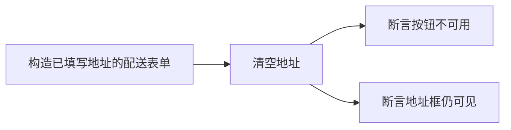

# 21.4 小结

## 重点回顾

!!! takeaway "划重点"

    - 中介者就是把跨控件的规则收进一处（本例的 `refresh`），任何输入一变就调用它；控件彼此不持有引用。
    - 输入变化后，用当前输入得出结果，不靠上一次刷新留下的状态。
    - 协调器只管理所属范围内的联动，不接管控件本身的职责。

## Q & A

**Q**：刷新时再改控件，会不会触发第二次刷新？

本例不会：`refresh` 只写地址框的可见性和按钮的可用性，不调用修改输入的方法。接入真实控件时，要确认程序设置属性会不会触发同一个事件，否则可能反复刷新。

**Q**：为什么不能直接复制 `Checkout`？

构造时保存的 `c.refresh` 绑定的是原对象。复制结构体会把回调也一起复制，副本里的控件变化却会通知原对象。需要另一张表单时，再调用 `NewCheckout`。

**Q**：中介者和观察者有什么区别？

观察者只管「通知谁」，收到后做什么由订阅者定；中介者管「收到后怎么协作」。详见[易混模式对比](../../compare.md#messaging)。

**Q**：怎么测试协调器，不搭真实界面可以吗？

可以。用代码模拟输入变化，检查控件状态即可。例如清空配送地址时，只检查按钮变为不可用还不够，还要确认地址框仍然显示，用户才能继续填写。

一个事件可以改动多个控件的状态，测试也要检查不应改变的状态

## 动手试试

1. **加一个配送费提示**：新增同事对象 `feeLabel`（只存 `text string`），放进 `Checkout`；在 `refresh` 里按配送选项设为「配送费 5 元」或空串，再加读取方法 `FeeText()`。

    提示：要改包内代码，克隆仓库后运行 `go test ./codes/behavioral/mediator`。检验：自取时 `FeeText()` 为空，`SetDelivery(true)` 后为「配送费 5 元」，切回自取又为空；`deliveryToggle`、`addressField` 一行没改，原有测试照常通过。

2. **复制协调器会发生什么**：`a := mediator.NewCheckout()`，`a.SetDelivery(true)` 后执行 `b := *a`，再 `b.SetAddress("松林路 8 号")`，打印 `b.AddressVisible()` 和 `b.CanSubmit()`。

    提示：可直接在本章 Playground 里完成。检验：输出 `true false`——地址已填却不能提交，因为 `b` 里的回调仍是 `a.refresh`，刷新的是 `a` 的按钮。

参考答案：[exercise_test.go](https://github.com/caticat/design-pattern/blob/master/codes/behavioral/mediator/exercise_test.go)（练习 1 需改动包内代码，答案见提示）
