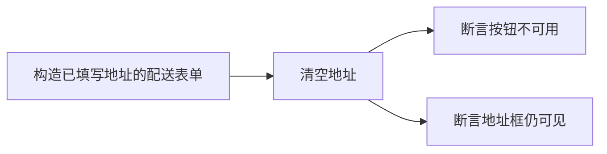

# 21.4 小结

## 重点回顾

!!! takeaway "划重点"

    - 控件不再彼此持有引用，协调器负责跨控件的协作。
    - 输入变化后，用当前输入得出结果，不靠上一次刷新留下的状态。
    - 协调器只管理所属范围内的联动，不接管控件本身的职责。

## Q & A

**Q**：刷新时再改控件，会不会触发第二次刷新？

本例不会：`refresh` 只写地址框的可见性和按钮的可用性，不调用修改输入的方法。接入真实控件时，要确认程序设置属性会不会触发同一个事件，否则可能反复刷新。

**Q**：为什么不能直接复制 `Checkout`？

构造时保存的 `c.refresh` 绑定的是原对象。复制结构体会把回调也一起复制，副本里的控件变化却会通知原对象。需要另一张表单时，再调用 `NewCheckout`。

**Q**：中介者和观察者有什么区别？

观察者关心「谁想收到变化通知」，由订阅者决定收到之后做什么。中介者关心「收到变化后该怎样协作」，本例的通知只是把控制权交给协调器。

**Q**：怎么测试协调器，不搭真实界面可以吗？

可以。用代码模拟输入变化，检查控件状态即可。例如清空配送地址时，只检查按钮变为不可用还不够，还要确认地址框仍然显示，用户才能继续填写。

一个事件可以改动多个控件的状态，测试也要检查不应改变的状态

