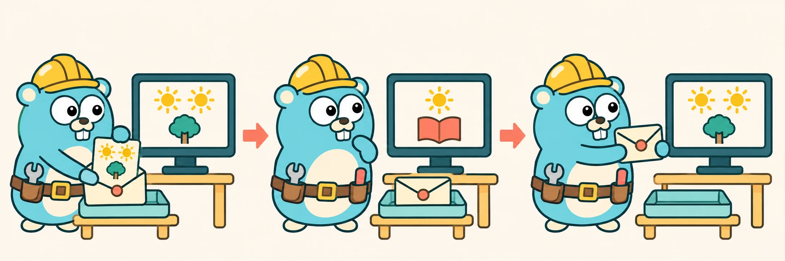

# 20.2 Go 实现

## 三步写完

一份快照对应一次撤销。本例把「改标题」和「改第一行」算作一次编辑，所以两者共用编辑前的同一份快照。

{ .illus }

<p class="caption">先封存旧稿，再改文稿；撤销时取出最近封存的一份</p>

**第 1 步**：让 `Editor` 自己保存标题和正文。外部用 `ReplaceLine` 改一行，用 `Text` 读取拼好的字符串，拿不到内部切片。

**第 2 步**：定义字段不导出的 `Memento`。`Save` 和 `Restore` 都用标准库 `slices.Clone`（Go 1.21 起）复制行切片：保存后改稿，不会改到快照；恢复后再改稿，也不会改到被用过的快照。本例每行都是不可变字符串，复制切片元素就够了。

```go
--8<-- "codes/behavioral/memento/memento.go:snapshot"
```

**第 3 步**：`History` 用切片做栈，`Checkpoint` 放到末尾，`Undo` 从末尾取出。撤销后清空弹出的槽位，不让栈继续引用那份快照。

```go
--8<-- "codes/behavioral/memento/memento.go:history"
```

## 使用示例

改完标题和第一行之后，一次撤销恢复两处；再撤一次没有记录，返回 `false`。调用方负责选定编辑边界；如果只是在输入框里移动光标，没有改动文稿，就不必留档，否则按一次撤销看不出变化。

```go
--8<-- "codes/behavioral/memento/example_test.go:example"
```

[:material-play: 在 Go Playground 运行](https://go.dev/play/p/s72ssl7Tiod){ .md-button .md-button--primary target=_blank }
