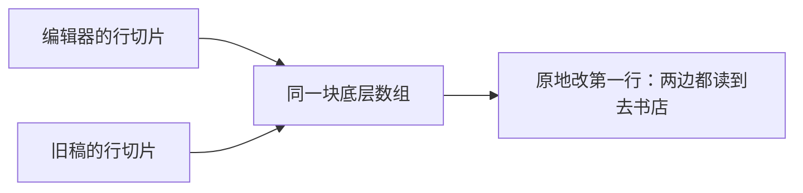
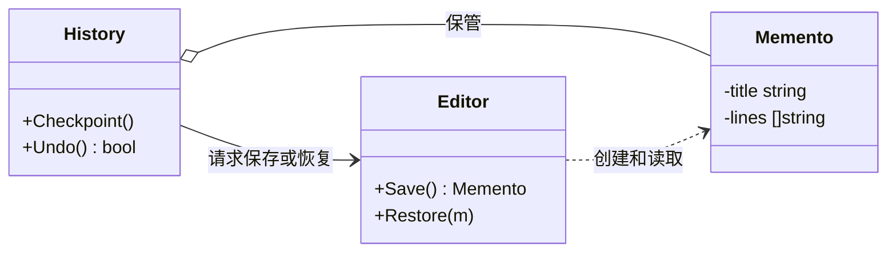

# 20.1 问题与思路

## 为什么旧稿也变了？

文本编辑器用一个字符串存标题、一个 `[]string` 存正文。用户想把标题从「周末计划」改成「周日计划」，把第一行从「去公园」改成「去书店」，还要能一次撤销这两处改动。

{ .illus }

<p class="caption">旧稿不是指向当前文稿的另一条路，而是一份独立保管的记录</p>

最直觉的做法是把字段赋给两个变量，撤销时原样赋回。标题恢复了，正文却还是「去书店」：

```go
--8<-- "codes/behavioral/memento/bad.go:bad"
```



<p class="caption">赋值只复制切片描述，没有复制装着各行的数组</p>

## 编辑器自己封存旧稿

==保存和恢复由编辑器负责，历史只保管快照==。编辑器知道哪些字段要一起撤销，也能在保存时复制数组；外部可以传递快照值，却不用知道它里面存的是切片还是别的结构。



<p class="caption">History 按顺序存取快照，不负责解释标题和正文</p>

| 角色 | 职责 | 本例中 |
|---|---|---|
| 原发器（Originator） | 生成快照并用它恢复自身状态 | `Editor` |
| 备忘录（Memento） | 封存需要恢复的状态 | `Memento` |
| 管理者（Caretaker） | 决定何时留档、用哪份快照撤销 | `History` |
