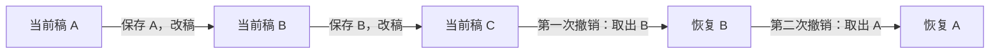

# 20.4 小结

## 重点回顾

!!! takeaway "划重点"

    - 让编辑器保存和恢复私有快照，历史只管理快照的顺序。
    - 快照与当前文稿不能共用可变数据；检查保存和恢复两侧。
    - 先定好一次撤销的边界，再决定什么时候保存。

最后一次保存的快照最先被取出，先恢复 B，再恢复 A

## Q & A

**Q**：如果快照里还有 map 或指针，`slices.Clone` 够吗？

不够。它只复制切片里的元素值；元素若还指向可变对象，两个版本依然会互相影响。要复制那部分可变数据，或明确约定那部分不可变。

**Q**：备忘录和命令模式都能做撤销，差别是什么？

备忘录保存「原来是什么」，撤销靠恢复状态；命令模式封装「做了什么」，也可让命令实现反向操作，或者让命令借助备忘录撤销。

**Q**：怎么在撤销之后再重做？

可加一个重做栈。撤销之前，把当前稿存入重做栈；重做之前，把当前稿存回撤销栈。撤销后如果用户开始一次新编辑，旧的重做分支就应清掉。

**Q**：能把编辑器甲的快照交给乙吗？

本例的快照只含文稿数据，恢复时不会检查来源；`History` 则只操作创建时绑定的编辑器。如果业务禁止跨文档恢复，就要在快照中记录文档身份，并在恢复前校验。

## 动手试试

1. **只保留最近 N 步的历史**：在包外写 `Limited`（字段：`*memento.Editor`、上限 `max`、`[]memento.Memento`），`Checkpoint` 调用 `Save` 压栈，超过 `max` 就丢掉最早一份；`Undo` 照 `History.Undo` 的写法调用 `Restore`。

    提示：管理者只存取 `Memento`，不需要知道里面有什么；可直接在本章 Playground 里完成。检验：`max` 为 2，标题依次改为 A、B、C、D（每次改前 `Checkpoint`）；连撤三次得到 `true C`、`true B`、`false B`，`Editor` 和 `Memento` 没改。

2. **撤销边界划错了会怎样**：照示例操作，但在 `Rename("周日计划")` 和 `ReplaceLine(0, "去书店")` 之间多调用一次 `h.Checkpoint()`，然后撤销两次，每次后打印标题和正文。

    提示：可直接在本章 Playground 里完成。检验：第一次撤销得到「周日计划：去公园」这个用户从没见过的中间稿，第二次才回到「周末计划：去公园」——留档时机就是撤销粒度。

参考答案：[exercise_test.go](https://github.com/caticat/design-pattern/blob/master/codes/behavioral/memento/exercise_test.go)
