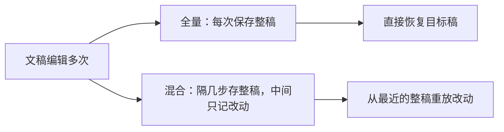

# 20.3 撤销历史怎么存

## 全量还是增量？

记正文有 `n` 行，连续保留 `k` 份大小相近的快照。本例每次复制 `n` 个字符串值，不复制字符串的字节；保存或恢复各需 `O(n)` 时间，历史中的行切片共占 `O(kn)` 个元素。快照仍可能让已经删掉的旧文本留在内存里。

整稿花空间换简单恢复；夹着存增量可以少存，但恢复时要多做几步

| 选法 | 怎么存 | 代价 |
|---|---|---|
| 限制全量快照数 | 保留最近若干份，超出就丢最早那份 | 写法不变，较旧的编辑不能再撤销 |
| 只存变化量 | 记录改了哪行、改前是什么；撤销时反向应用 | 改一行存得少，但要为每种操作定义怎么反做 |
| 整稿加变化量 | 定期存整稿，中间记可重放的改动 | 任意选点恢复要从基准稿重放，维护成本更高 |

标准库 `math/rand/v2.PCG`（Go 1.22 起）体现了同样的封装：`MarshalBinary` 保存生成器的内部状态，`UnmarshalBinary` 恢复后，下一次 `Uint64` 会从保存的位置继续。这是单个快照的保存与恢复，不包含撤销历史。

## 什么时候用

!!! success "适合"

    - 多个字段必须一起回退，调用方不该逐个恢复。
    - 配置对话框要支持「取消」，一份打开前的快照就够。

!!! failure "不适合"

    - 大文档每敲一个字就复制整稿，先考虑按操作合并或记增量。
    - 邮件已经送出，恢复本地草稿也撤不回已发生的外部动作。

