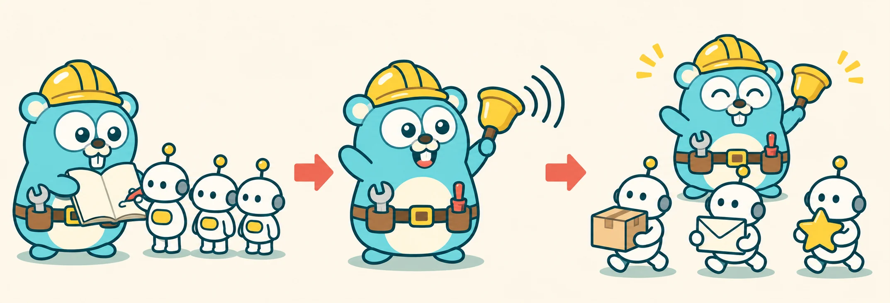

# 14.2 Go 实现

## 三步写完

**第 1 步**：事件内容和观察者接口。接口只有一个方法：事件发生时被调用。

```go
--8<-- "codes/behavioral/observer/observer.go:observer"
```

**第 2 步**：主题。保存观察者列表，`Subscribe` 往里加，`Pay` 成功后遍历通知。

```go
--8<-- "codes/behavioral/observer/observer.go:subject"
```

**第 3 步**：具体观察者，各自实现 `OnPaid`，只管自己的事。

```go
--8<-- "codes/behavioral/observer/observer.go:concrete"
```

{ .illus }

<p class="caption">先登记，再摇铃；铃声响起，每个订阅者各忙各的</p>

!!! tip "通知是同步的"

    `Pay` 会依次调用每个 `OnPaid`，全部返回后才结束。某个观察者很慢，整个支付都会被拖慢，处理方法见 [14.4 小结](summary.md)。

## 使用示例

新加的 `Coupon` 写在包外，`Shop` 的代码一行不改：

```go
--8<-- "codes/behavioral/observer/example_test.go:example"
```

[:material-play: 在 Go Playground 运行](https://go.dev/play/p/TODO){ .md-button .md-button--primary target=_blank }
