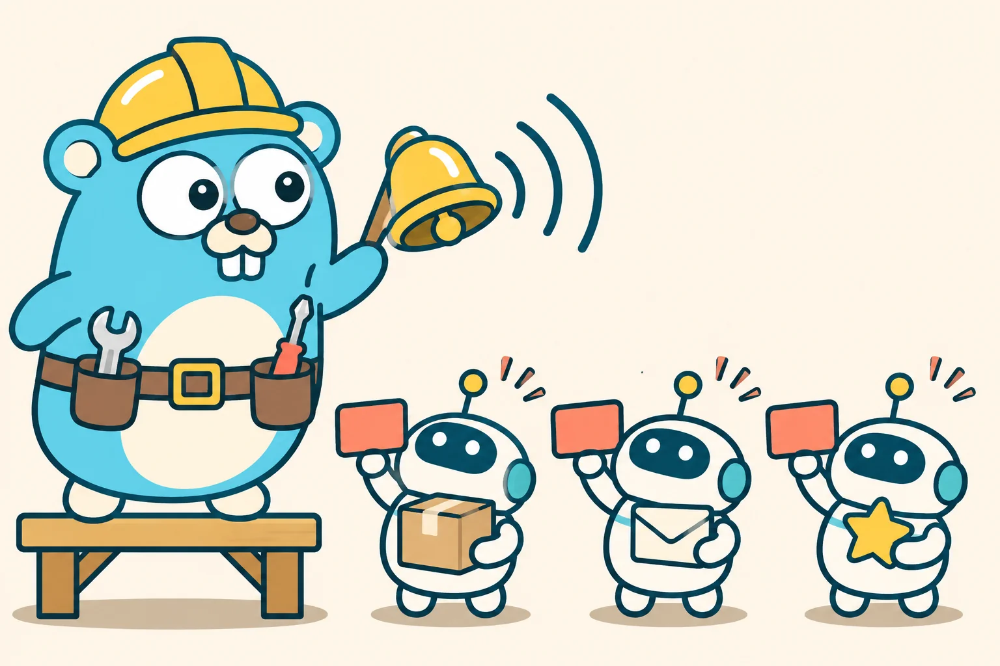

# 观察者模式

:material-shape-outline: 行为型
:material-signal-cellular-1: 难度 入门
:material-fire: 使用频率 高

{ .cover }

!!! abstract ""

    订单支付成功后，库存要扣减、用户要收短信、账户要加积分。把这些都写在支付代码里，每多一件事就得改一次支付。

    观察者模式让关心这件事的模块**自己来订阅**；支付成功后只需挨个通知，不用知道对方是谁、要做什么。

## 本章内容

| 节 | 内容 |
|---|---|
| [14.1 问题与思路](problem.md) | 下游越来越多，订阅与通知怎么解决 |
| [14.2 Go 实现](implementation.md) | 观察者接口、主题、具体观察者 |
| [14.3 Go 里的观察者](stdlib.md) | 函数订阅与取消、标准库中的例子、什么时候用 |
| [14.4 小结](summary.md) | 重点回顾、常见问题与动手试试 |

**前置知识**：[附录 C 函数值与回调](../../appendix/callbacks.md) · [附录 A 并发](../../appendix/concurrency.md) · [附录 D 怎么读类图](../../appendix/class-diagram.md)　**相关对比**：[对象之间传消息](../../compare.md#messaging)
