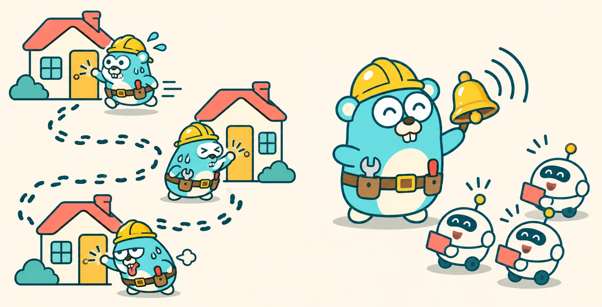
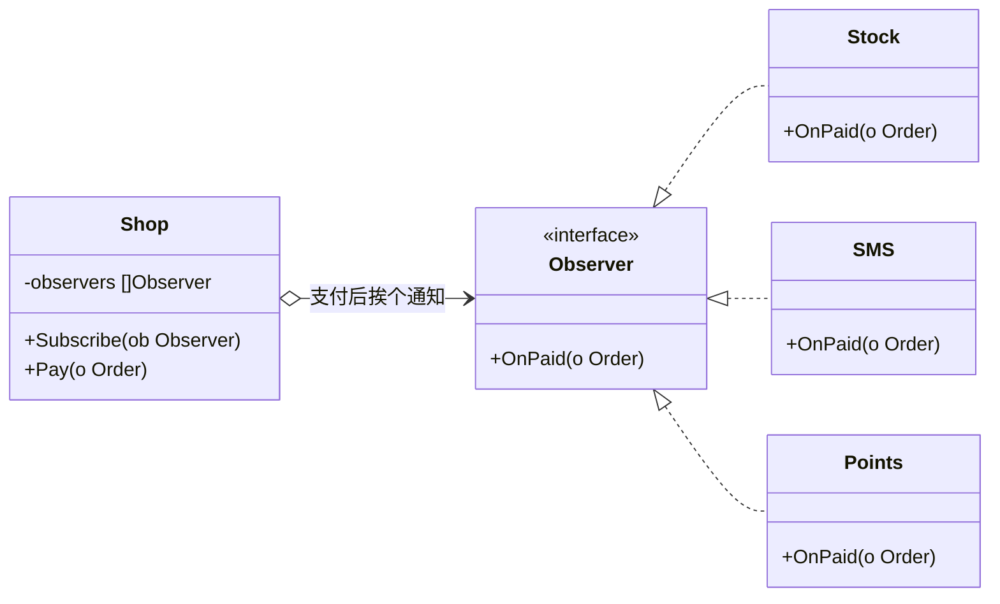

# 14.1 问题与思路

## 一件事发生，很多地方要知道

网店的订单支付成功后：库存要扣减、要给用户发短信、要加积分，以后可能还要发优惠券。

{ .illus }

<p class="caption">挨家挨户跑腿，多一户就多跑一趟；摇一下铃，订阅了的自己会听到</p>

最直觉的写法：支付成功后，直接调用每个相关模块：

```go
--8<-- "codes/behavioral/observer/bad.go:bad"
```

| 痛点 | 后果 |
|---|---|
| 每加一个下游都要改支付代码 | 支付越写越长，改一处可能影响所有 |
| 支付依赖所有下游模块 | 不能单独测试支付，也不能在运行时增减下游 |

根本原因：**发出事件的一方直接调用每个接收方**，谁要知道、知道后做什么，都写死在发出方里。

## 订阅，然后通知

1. 定义观察者接口 `Observer`，==所有想知道「支付成功」的模块都实现它==。
2. 商店 `Shop` 只保存一份观察者列表：谁关心就来 `Subscribe`；支付成功后挨个通知，不关心对方是谁。



<p class="caption">Shop 只认识 Observer 接口；加一个下游，只是多一次 Subscribe</p>

| 角色 | 职责 | 本例中 |
|---|---|---|
| 主题（Subject） | 维护观察者列表，事件发生时通知 | `Shop` |
| 观察者（Observer） | 收到通知时被调用的接口 | `Observer` |
| 具体观察者（Concrete Observer） | 收到通知后做自己的事 | `Stock`、`SMS`、`Points` |
| 客户端（Client） | 决定谁订阅谁 | 组装代码 |
