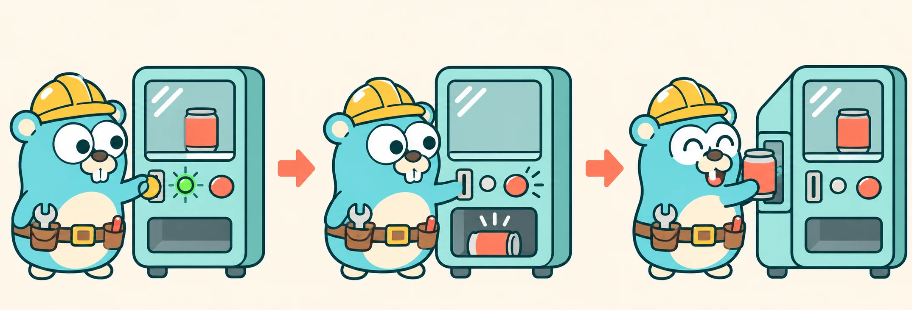

# 19.2 Go 实现

## 三步写完

售货机只装一罐，出货即售罄。代码用返回的提示模拟收币、退币和出货，不涉及硬件控制：

{ .illus }

<p class="caption">投币后可以出货，最后一罐卖掉后只能靠补货回到待投币</p>

**第 1 步**：定义 `vendingState` 接口。`Machine` 不读库存或付款标志；`Press` 只把请求交给 `m.current.press(m)`。传入机器本身，是为了让状态有地方写回下一状态。

```go
--8<-- "codes/behavioral/state/state.go:machine"
```

**第 2 步**：实现待投币。`ready` 不含数据：它的类型就代表「有货但未付款」。投币时替换 `current`，按键和补货则只返回提示。

```go
--8<-- "codes/behavioral/state/state.go:ready"
```

**第 3 步**：实现已投币和已售罄。在 `paid` 出货后立即换成 `soldOut`；只有 `soldOut` 接受补货，补完回到 `ready`。退币不等于换状态，所以相应方法不写 `current`。

```go
--8<-- "codes/behavioral/state/state.go:other_states"
```

## 使用示例

同样的 `Press`，投币前只提示，投币后才出货。

```go
--8<-- "codes/behavioral/state/example_test.go:example"
```

[:material-play: 在 Go Playground 运行](https://go.dev/play/p/KVV5LNUfDcL){ .md-button .md-button--primary target=_blank } [:material-github: 查看完整源码](https://github.com/caticat/design-pattern/tree/master/codes/behavioral/state){ .md-button target=_blank }
