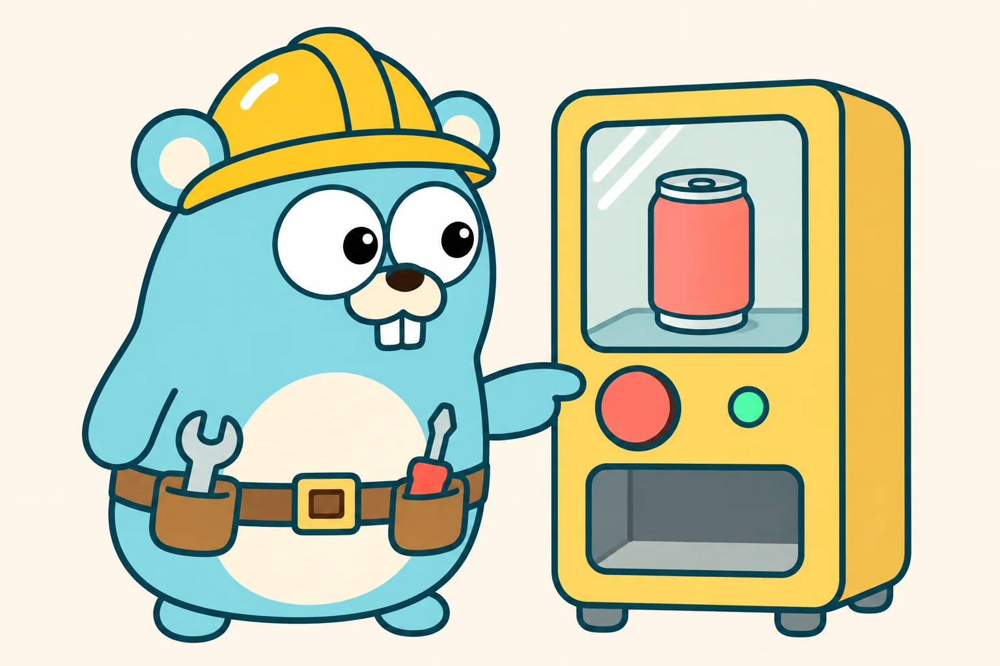

# 状态模式

:material-shape-outline: 行为型
:material-signal-cellular-1: 难度 入门
:material-fire: 使用频率 中

{ .cover }

!!! abstract ""

    售货机上只有一个出货按钮：投币前按，机器提醒你投币；投币后再按，机器就吐出饮料。手指按的是同一个按钮，变的是机器所处的阶段。

    状态模式（State）把**随内部状态而变的行为**交给各个状态对象，调用方不必先判断当前处于哪个阶段。

## 本章内容

| 节 | 内容 |
|---|---|
| [19.1 问题与思路](problem.md) | 售货机的放行条件为什么容易漏 |
| [19.2 Go 实现](implementation.md) | 机器委托操作，状态决定何时切换 |
| [19.3 状态机怎么写](state-machine.md) | 用转换图检查规则，比较三种写法 |
| [19.4 小结](summary.md) | 重点回顾与常见问题 |
