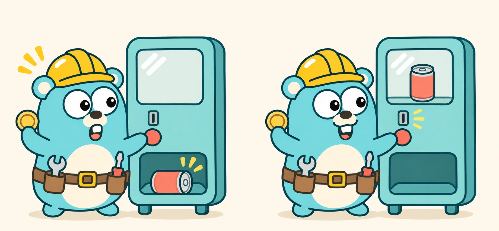
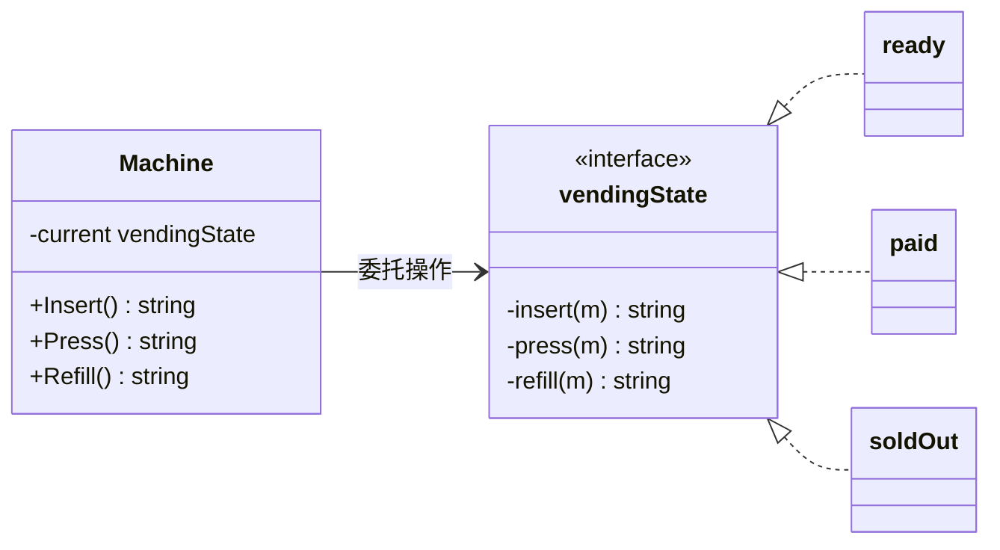

# 19.1 问题与思路

## 有货就能出货吗？

一台售货机最多装一罐饮料。它有三个操作：投币、按出货按钮、补货。饮料卖完后，机器要退回投入的硬币；补货后，顾客得重新投币。

{ .illus }

<p class="caption">有货不等于可以买走：投币前按键只提示，不出货</p>

最直觉的写法：用 `stocked` 和 `paid` 记录有没有货、有没有收币，每个入口自己判断。写投币时记得查库存，写出货时却可能忘记再查付款：

```go
--8<-- "codes/behavioral/state/bad.go:bad"
```

反例缺了付款检查，未投币按键也会出货。

## 按状态组织操作

把「待投币」「已投币」「已售罄」各写成一个类型。机器只保存其中一个，收到操作就转交；==下一步能做什么，由当前状态决定==。比如「待投币」收到按键只返回提示，不会更新状态；收到硬币才切到「已投币」。



<p class="caption">机器只委托给接口，三个具体状态分别实现投币、按键和补货</p>

| 角色 | 职责 | 本例中 |
|---|---|---|
| 上下文（Context） | 提供稳定的操作入口，持有当前状态 | `Machine` |
| 状态（State） | 约定每个阶段必须处理哪些操作 | `vendingState` |
| 具体状态（Concrete State） | 实现本阶段的行为，必要时切换状态 | `ready`、`paid`、`soldOut` |
