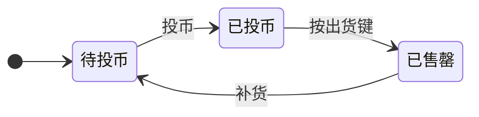

# 19.3 状态机怎么写

## 先画转换，再选写法

状态机（State Machine）描述的是「当前在哪一步，遇到某个事件后去哪一步」。图上只画实际发生的切换；没画的操作仍要定义回应，例如已投币时再次投币，应退币并留在原状态。

三条转换连成一轮；按键本身不能从待投币跳到售罄

状态模式是写状态机的一种办法，不是唯一办法。选写法时，先看最常改的是转换规则，还是每个阶段要做的事。

| 写法 | 怎么组织 | 适合 |
|---|---|---|
| 枚举 + `switch` | 由一个入口按状态分支 | 状态少、分支短，还能一眼看全 |
| 转换表 | 用「当前状态 + 事件」查下一状态 | 主要在查能不能转，动作简单 |
| 状态对象 | 每个状态实现一组操作 | 同一操作在各阶段差别大，且阶段内部逻辑会继续长 |

标准库 `encoding/json` 的 `scanner` 也按阶段处理输入，不过它只保存一个 `step` 函数。读到开引号时，从 `stateBeginValue` 换到 `stateInString`，下一个字节就按字符串内的规则处理。只有一个操作（处理下一个字节）时，函数足以代表状态。

## 什么时候用

!!! success "适合"

    - 多个入口反复判断同一组阶段，改一个阶段要到处找分支。
    - 每个阶段有自己的校验、回应和动作，独立测试更清楚。

!!! failure "不适合"

    - 订单只有一个「是否归档」标志，仅用来显示标签。
    - 新增的操作每个状态都要实现，但多数实现都是一样的。

