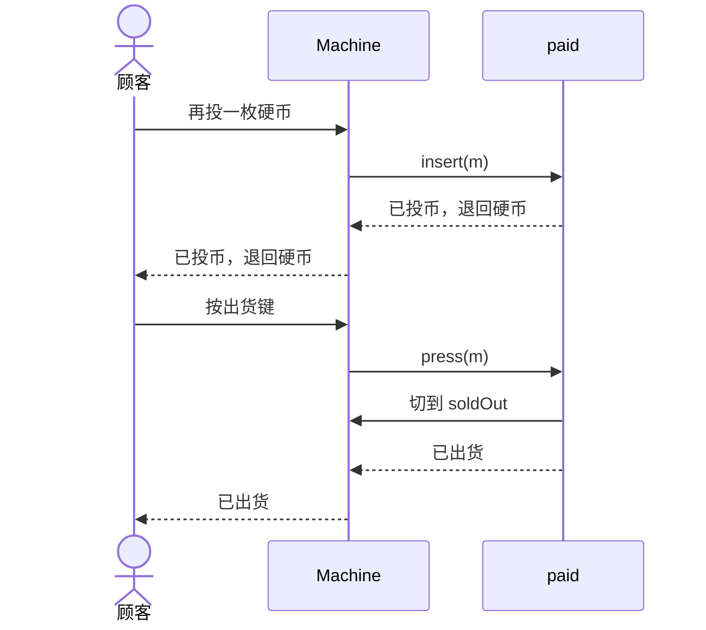

# 19.4 小结

## 重点回顾

!!! takeaway "划重点"

    - 状态模式把各阶段的行为放到各自的类型里，机器负责委托。
    - 测试不只看能否切换，还要验证操作被拒绝后是否留在原状态。

重复投币被拒绝后仍是已投币，原来买到的一罐还能取走

## Q & A

**Q**：状态模式和策略模式都在换接口实现，怎么区分？

策略通常由调用方或配置选，用来决定一件事「怎么做」。状态随对象处理事件而变化，决定「现在能做什么、做完去哪」。

**Q**：状态一定要自己决定下一状态吗？

不一定。本例在状态方法里切换，读到动作就能看到去向；如果跨阶段的约束很多，也可由机器统一检查后再切换，让转换关系集中可查。

**Q**：真实售货机能放很多罐，难道每个库存数字都要一个类型？

不用。库存是数量，放在机器上；「能否继续卖」才是阶段。成功出货后减库存：还有货转回待投币，卖完才转售罄。

**Q**：并发调用 `Insert`、`Press` 安全吗？

不安全。本例只演示顺序调用。需要并发时，可用[互斥锁](../../appendix/concurrency.md)保护整个入口，让「读状态、执行、切换」一次做完，别的操作不能插进来。

## 动手试试

1. **改成两枚硬币一罐**：新增状态 `onePaid`（已投一枚），实现 `insert`、`press`、`refill`；把 `ready.insert` 的目标从 `paid{}` 改成 `onePaid{}`，提示改为「已收币，还差 1 枚」。

    提示：要改包内代码，克隆仓库后运行 `go test ./codes/behavioral/state`。检验：依次投币、按键、投币、投币、按键，得到「已收币，还差 1 枚 / 还差 1 枚硬币 / 已收币 / 已投币，退回硬币 / 已出货」；`Machine`、`paid`、`soldOut` 一行没改，原有测试和示例失败只因规则变了，按新规则更新期望即可。

2. **并发调用暴露数据竞争**：在包外起 10 个 goroutine，各自对同一台 `NewMachine()` 调用 `Insert` 和 `Press`，用 `go test -race` 运行；再写包装类型 `SafeMachine`，用 `sync.Mutex` 包住每个入口后重跑。

    提示：Playground 不支持 `-race`，需在本地运行。检验：直接调用时报告 `DATA RACE`（读写 `Machine.current`）；加锁后无报告，且 10 次 `Press` 中恰好 1 次是「已出货」。
