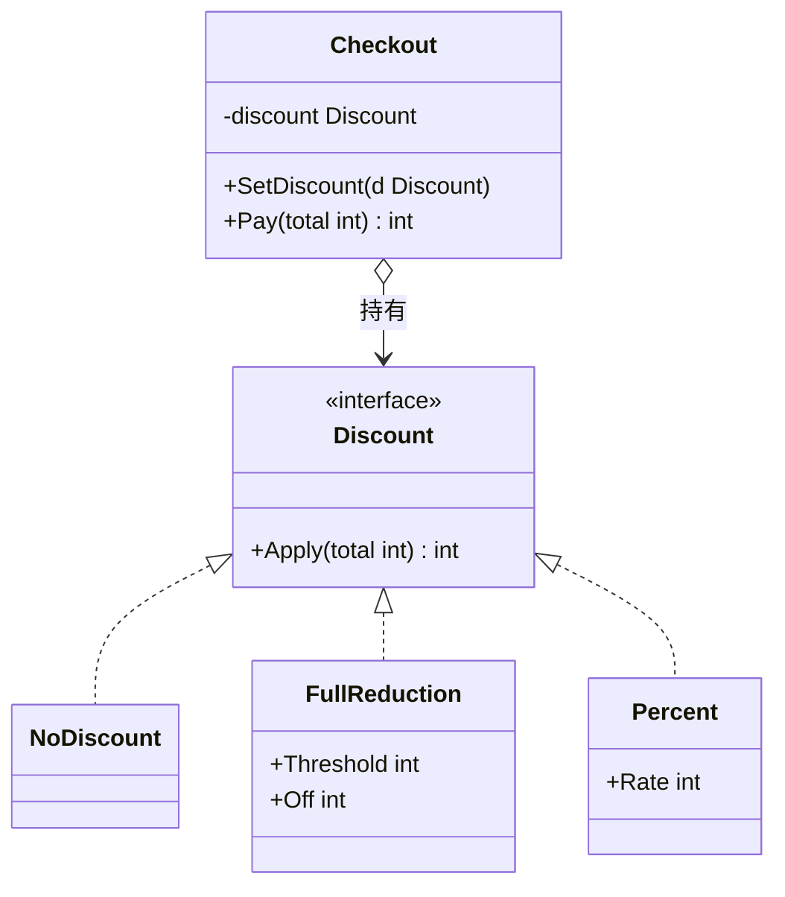

# 策略模式

!!! abstract "一句话"
    把一组可以互相替换的**算法**分别封装起来，让使用方在运行时自由切换。


<p class="caption">路口的指示牌越挂越乱；换成一台导航仪，插上「步行 / 骑行 / 驾车」卡片就换一种路线算法，目的地不变</p>

## 问题

商城结算要支持多种优惠：无优惠、满减、打折……最直觉的写法是一个 `switch`：

```go
--8<-- "codes/behavioral/strategy/bad.go:bad"
```

每加一种优惠，就要改这个函数：`switch` 越来越长，测试要跟着全部重跑，几个人同时改还容易冲突。根本原因是**「怎么算」和「什么时候算」耦合在了一起**。

## 方案

把每种算法抽成一个实现同一接口的类型（策略），结算逻辑（上下文）只依赖接口。



| 角色 | 职责 | 本例中 |
|---|---|---|
| 策略（Strategy） | 定义算法的统一接口 | `Discount` |
| 具体策略 | 实现某一种算法 | `NoDiscount`、`FullReduction`、`Percent` |
| 上下文（Context） | 持有策略，在需要时调用 | `Checkout` |

## Go 实现

**第 1 步**：定义策略接口。

```go
--8<-- "codes/behavioral/strategy/strategy.go:interface"
```

**第 2 步**：每种优惠一个类型。

```go
--8<-- "codes/behavioral/strategy/strategy.go:concrete"
```

**第 3 步**：上下文只认接口，策略可随时替换。

```go
--8<-- "codes/behavioral/strategy/strategy.go:context"
```

**Go 特色**：只有一个方法的策略，可以直接用函数类型实现接口（与标准库 `http.HandlerFunc` 同一手法），临时规则无需新建类型：

```go
--8<-- "codes/behavioral/strategy/strategy.go:func"
```

使用示例：

```go
--8<-- "codes/behavioral/strategy/example_test.go"
```

[:material-play: 在 Go Playground 运行](https://go.dev/play/p/9rAmR8mVEtL){ .md-button target=_blank }

新增一种优惠，只需新写一个类型（或一个函数），`Checkout` 一行不改。

## 什么时候用

| 适合 | 不适合 |
|---|---|
| 同一件事有多种做法，且会继续增加 | 只有两三种分支、几乎不会变，`if` 更直白 |
| 需要在运行时根据配置或用户选择切换算法 | 各分支之间差异很小，抽接口反而啰嗦 |
| 想单独测试每一种算法 | 算法需要大量访问上下文内部数据 |

## 小结

- 策略 = **把「怎么做」抽成可替换的对象**，上下文只管「何时做」。
- 用接口取代 `switch`：新增算法只加代码、不改旧代码（开闭原则）。
- Go 中单方法策略优先用函数或函数类型，更轻量。

??? note "进阶：Go 惯用写法"
    Go 的函数是一等公民，很多场景下策略就是**一个函数参数**，连接口都不需要：

    ```go
    func Pay(total int, discount func(int) int) int { return discount(total) }
    ```

    | 写法 | 适用 |
    |---|---|
    | 函数参数 `func(int) int` | 策略无状态、只用一次 |
    | 函数类型 + 方法（`DiscountFunc`） | 既想传函数，又要满足接口 |
    | 接口 + 结构体 | 策略带配置参数，或有多个方法 |

??? note "进阶：标准库中的策略模式"
    - `slices.SortFunc(s, cmp)`（Go 1.21+）：排序流程固定，比较规则 `cmp` 由调用方传入。
    - `sort.Sort(data sort.Interface)`：通过接口注入比较与交换逻辑。
    - `bufio.Scanner.Split(bufio.ScanWords)`：按行、按单词、按字节切分，换一个 `SplitFunc` 即换一种策略。
    - `http.Handler` / `http.HandlerFunc`：服务器框架固定，「如何处理请求」由你提供。

??? note "进阶：策略与相似模式的区别"
    | 对比 | 区别 |
    |---|---|
    | 状态模式 | 结构几乎一样；但状态由对象**自己**在内部切换，策略由**使用方**从外部选择 |
    | 模板方法 | 模板方法固定流程、替换其中**某几步**；策略替换**整个算法** |
    | 命令模式 | 命令封装「做什么」（一次请求，可排队撤销）；策略封装「怎么做」 |

??? warning "常见误用"
    - **为两个分支硬上策略**：接口、类型、工厂一套下来，比原来的 `if` 难读得多。
    - **使用方仍需 `switch` 选策略**：选择逻辑只是换了个位置。可以用 `map[string]Discount` 注册表收敛到一处。
    - **策略之间共享可变状态**：策略应尽量无状态，否则切换时容易出现奇怪的结果。
