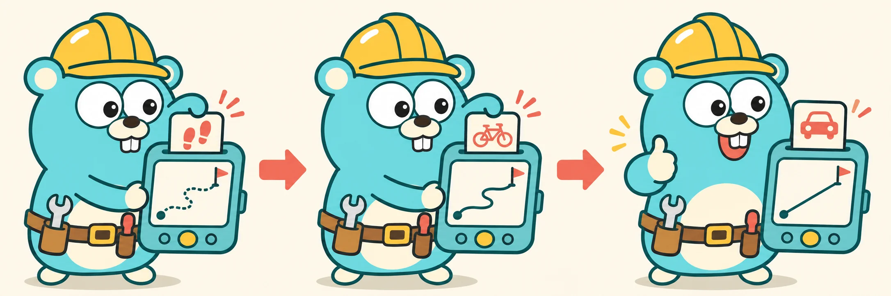

# 13.2 Go 实现

## 三步写完

**第 1 步**：定义策略接口。

```go
--8<-- "codes/behavioral/strategy/strategy.go:interface"
```

**第 2 步**：每种优惠一个类型。

```go
--8<-- "codes/behavioral/strategy/strategy.go:concrete"
```

**第 3 步**：上下文只认接口，策略可随时替换。

```go
--8<-- "codes/behavioral/strategy/strategy.go:context"
```

## 运行时切换

{ .illus }

<p class="caption">SetDiscount 就是换一张卡：算法变了，收银台和调用它的代码都没变</p>

同一个收银台，依次换上不同的优惠：

```go
--8<-- "codes/behavioral/strategy/example_test.go"
```

[:material-play: 在 Go Playground 运行](https://go.dev/play/p/gTZOdSt3c6F){ .md-button .md-button--primary target=_blank }

最后一段直接用函数当策略，不必新建类型，原理见 [13.3 函数即策略](functions.md)。

!!! tip "新增一种优惠要改哪里？"

    只新写一个实现 `Discount` 的类型（或一个函数）。`Checkout` 和已有的优惠一行都不用改。
