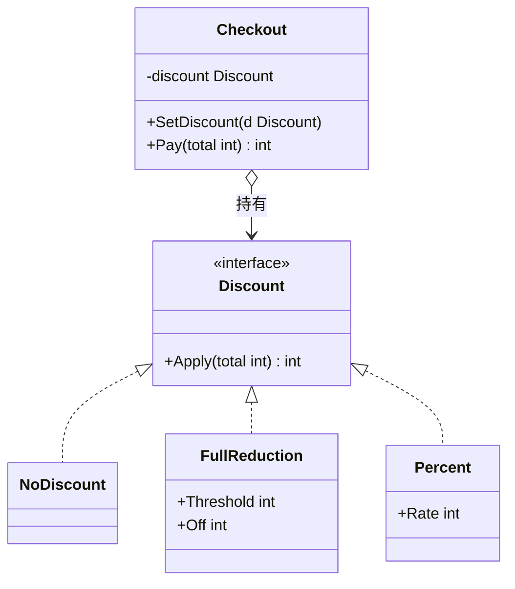

# 13.1 问题与思路

## 越写越长的 switch

商城结算要支持多种优惠：无优惠、满减、打折……就像路口要指向多个方向。

{ .illus }

<p class="caption">把所有路线都挂在路口，牌子越挂越乱；换成可插卡的导航仪，每种路线一张卡</p>

最直觉的写法是一个 `switch`：

```go
--8<-- "codes/behavioral/strategy/bad.go:bad"
```

| 痛点 | 后果 |
|---|---|
| 每加一种优惠都要改 `PayBad` | 改一处，所有优惠都要重新测 |
| 所有规则挤在一个函数里 | 越来越长，难读；多人同时改容易冲突 |
| 规则不能单独复用 | 别处想用「满减」，只能复制代码 |

根本原因：**「怎么算」和「什么时候算」写在了一起**。

## 把「怎么算」抽出去

1. 每种优惠写成一个类型，都实现同一个接口 `Discount`（策略）。
2. 结算逻辑 `Checkout`（上下文）只持有这个接口，需要时调用它。

==上下文只认接口，新增算法只加一个类型，旧代码一行不改==。



<p class="caption">Checkout 只依赖 Discount 接口，具体用哪种优惠由外部传入</p>

| 角色 | 职责 | 本例中 |
|---|---|---|
| 策略（Strategy） | 定义算法的统一接口 | `Discount` |
| 具体策略 | 实现某一种算法 | `NoDiscount`、`FullReduction`、`Percent` |
| 上下文（Context） | 持有策略，在需要时调用 | `Checkout` |
