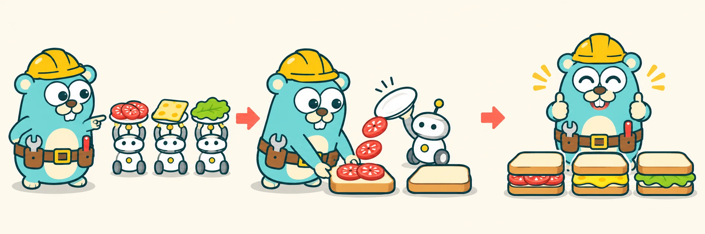

# 15.2 Go 实现

## 三步写完

**第 1 步**：把会变的步骤写成接口。必选步骤放进 `Exporter`；可选步骤单独一个接口 `Footer`，作为钩子。

```go
--8<-- "codes/behavioral/templatemethod/export.go:steps"
```

**第 2 步**：模板函数。流程、顺序和公共部分（空数据检查、换行）都在这里；钩子用类型断言判断有没有实现。

```go
--8<-- "codes/behavioral/templatemethod/export.go:template"
```

**第 3 步**：具体格式只实现自己的步骤。`CSV` 用标准库处理字段里的逗号、引号和换行；记录末尾的换行仍由 `Export` 统一添加。

```go
--8<-- "codes/behavioral/templatemethod/export.go:concrete"
```

{ .illus }

<p class="caption">各自只准备自己的馅；面包按固定顺序放；做出来的三明治结构一致</p>

!!! tip "为什么是函数，不是方法"

    Go 没有继承，没法像 Java 那样把流程写在父类里，再由子类覆盖步骤。最直接的写法就是：**模板方法 = 接收步骤接口的普通函数**。原因见 [15.3](stdlib.md)。

## 使用示例

新加的 `Text` 写在包外，`Export` 的代码一行不改：

```go
--8<-- "codes/behavioral/templatemethod/example_test.go:example"
```

[:material-play: 在 Go Playground 运行](https://go.dev/play/p/N2lxHw7YjUy){ .md-button .md-button--primary target=_blank }
