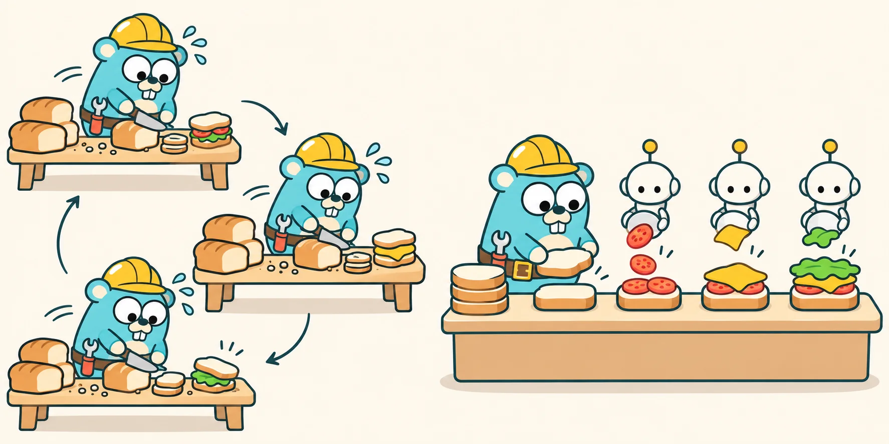
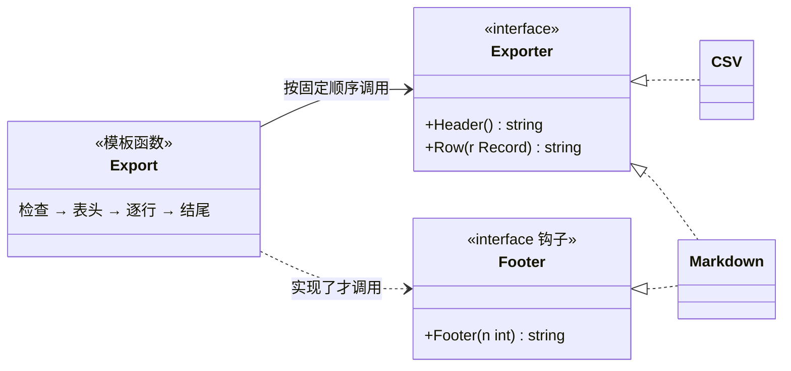

# 15.1 问题与思路

## 同一套流程，复制了好几份

成绩报表要导出成 CSV 和 Markdown：流程一样（检查、表头、逐行、结尾），只是写出的文字不同。

{ .illus }

<p class="caption">每种三明治都从切面包做起，重复又容易做走样；面包流程固定下来，只换中间的馅</p>

最直觉的写法：每种格式写一个完整的导出函数：

```go
--8<-- "codes/behavioral/templatemethod/bad.go:bad"
```

| 痛点 | 后果 |
|---|---|
| 流程在每个函数里复制一份 | 改流程（如加导出时间）要改所有函数，漏一个就不一致 |
| 加一种格式就要再抄一遍流程 | 代码越来越多，新格式很容易少一步 |

根本原因：**不变的流程和会变的步骤写在了一起**，想换步骤只能把流程一起复制。

## 流程固定，步骤交出去

1. 把会变的步骤抽成接口 `Exporter`（写表头、写一行），==每种格式只实现这几步==，不碰流程。
2. 模板函数 `Export` 按固定顺序调用这些步骤；可选的步骤做成**钩子** `Footer`，实现了才调用。



<p class="caption">流程只在 Export 里写一次；CSV 只实现必选步骤，Markdown 还实现了钩子</p>

| 角色 | 职责 | 本例中 |
|---|---|---|
| 模板方法（Template Method） | 定义流程骨架和步骤顺序 | `Export` |
| 抽象步骤（Primitive Operation） | 必须由具体类实现的步骤 | `Exporter` 的 `Header`、`Row` |
| 钩子（Hook） | 可选步骤，不实现就跳过 | `Footer` |
| 具体类（Concrete Class） | 实现各个步骤 | `CSV`、`Markdown` |
