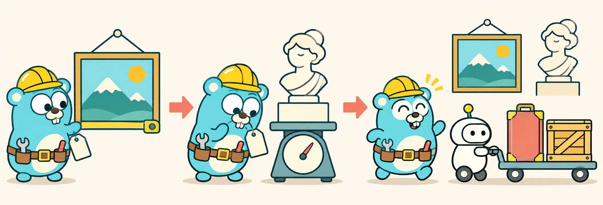

# 22.2 Go 实现

## 三步把操作从展品中拿出来

{ .illus }

<p class="caption">做展签要读不同的数据；换成备箱，同一批展品就按各自的类型计数</p>

**第 1 步**：定义两个接口。`Exhibit` 只要求能接待访问者；`Visitor` 要求能处理本例的两种展品。Go 不支持同名方法按参数类型重载，所以两个方法各用一个名字。

```go
--8<-- "codes/behavioral/visitor/visitor.go:contracts"
```

**第 2 步**：展品实现 `Accept`。调用 `e.Accept(v)` 时，先由 `e` 的实际类型选中 `Accept`；再由 `v` 的实际类型选中对应的访问方法实现。这两次选择合起来叫双分派（Double Dispatch）。

```go
--8<-- "codes/behavioral/visitor/visitor.go:exhibits"
```

**第 3 步**：每项工作各写一个访问者。写展签时读尺寸或重量；备箱时只计数。方法用指针接收者，结果累积在同一个访问者实例上。

```go
--8<-- "codes/behavioral/visitor/visitor.go:operations"
```

## 使用示例

循环不区分画作与雕塑，只把两位访问者交给每件展品。展签按访问顺序保存，箱数在走完整个列表后读取。

```go
--8<-- "codes/behavioral/visitor/example_test.go:example"
```

[:material-play: 在 Go Playground 运行](https://go.dev/play/p/ii44fdztZZE){ .md-button .md-button--primary target=_blank } [:material-github: 查看完整源码](https://github.com/caticat/design-pattern/tree/master/codes/behavioral/visitor){ .md-button target=_blank }
