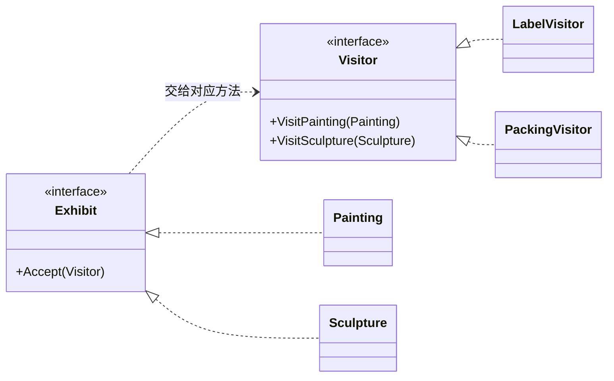

# 22.1 问题与思路

## 每做一项工作，就要重认一遍展品

博物馆用画作和雕塑两种类型记录展品。展签要写画作的尺寸或雕塑的重量；运输按类型备箱，每幅画一个画箱，每件雕塑一个木箱。

{ .illus }

<p class="caption">把每项工作交给一位访问者，展品只负责把自己交给对应的方法</p>

一个直接的做法是在两项操作里各写一个类型分支（type switch）。既有类型少、操作也少时，这么写容易读懂。操作一多，每处都得重复维护同一张类型清单。

```go
--8<-- "codes/behavioral/visitor/bad.go:bad"
```

例如新增陶器，只改展签分支、忘改备箱分支，程序照样编译，箱数却少了。

## 展品认得自己，访问者认得工作

每个展品提供 `Accept`，==把自己交给访问者的对应方法==。例如，画作只负责转到 `VisitPainting`，写展签还是数画箱，由传入的访问者决定。类型清单放进 `Visitor` 接口，新增展品类型时，漏写对应方法会在使用该访问者时导致编译失败——代价是每个访问者都要补上这个方法，[22.3](tradeoffs.md) 会展开。



<p class="caption">展品依赖访问者接口，不依赖具体的展签或备箱操作</p>

| 角色 | 本例中 | 职责 |
|---|---|---|
| 元素（Element） | `Exhibit`、`Painting`、`Sculpture` | 保存数据，选择匹配自身类型的访问方法 |
| 访问者 | `Visitor`、`LabelVisitor`、`PackingVisitor` | 为每种展品定义一项操作怎样执行 |
| 对象结构（Object Structure） | `[]Exhibit` | 保存不同类型的展品，供调用方遍历 |
