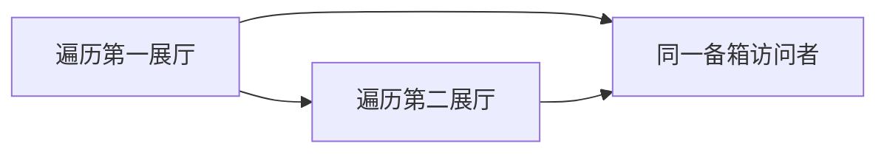

# 22.4 小结

## 重点回顾

!!! takeaway "划重点"

    - 展品用 `Accept` 选中对应的访问方法，具体怎么处理由访问者决定。
    - 每项操作由一个访问者实现，适合展品类型稳定、操作经常增加的场景。
    - 加展品类型要扩展访问者接口；遍历顺序则由调用方或集合决定。

## Q & A

**Q**：为什么不能直接写成 `v.Visit(e)`？

可以，但接口只能约定一个 `Visit(Exhibit)`。方法收到的仍是接口值，要读画作尺寸或雕塑重量，就得在里面判断实际类型。分开写访问方法，参数一开始就是具体类型。

**Q**：复用同一个备箱访问者处理两批展品，会怎样？

第二批会累加到第一批的结果上。如果要分开核算，每批新建一个访问者；如果要合计，复用同一个正好。展品本身不保存这份计数。

**Q**：展品后来分成多个展厅，遍历要写在 `Accept` 里吗？

不必。可以让遍历函数按展厅顺序把展品交给同一个访问者。这样换路线不影响展签和备箱逻辑，访问方法也不必知道展厅层级。

遍历负责挑出下一件展品，访问者只累积当前这件的处理结果

**Q**：访问者能直接修改展品吗？

本例按值传递，访问方法拿到的是展品的副本。若操作需要修改展品本身，可以改成指针接收者的 `Accept` 和接收展品指针的访问方法，并明确哪些访问者会修改数据。

## 动手试试

1. **新增「称重」操作**：在包外写 `WeightVisitor`，只累加雕塑的 `WeightKG`，遇到画作什么也不做；用它走一遍海风（12 千克）、晨光、远山（30 千克）。

    提示：可直接在本章 Playground 里完成。检验：总重 42；`Painting`、`Sculpture` 和两个已有访问者一行没改。

2. **值接收者的访问者**：写 `Counter{N int}`，两个访问方法都用值接收者执行 `c.N++`，把 `Counter{}` 交给上面三件展品的 `Accept`，最后打印 `N`。

    提示：可直接在本章 Playground 里完成。检验：能编译，但 `N` 仍是 0——每次 `Accept` 收到的是副本；改成指针接收者并传 `&Counter{}` 后得到 3。

参考答案：[exercise_test.go](https://github.com/caticat/design-pattern/blob/master/codes/behavioral/visitor/exercise_test.go)
