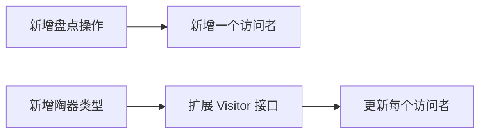

# 22.3 新增操作还是新增类型

## 先看哪边更常变

每种展品都可能遇到每项操作，像一张表：展品是列，操作是行。访问者把一整行装进一个类型。下次要加「盘点」，只要新增一个访问者；如果要加「陶器」，就得扩展接口，并为现有访问者补上这一列。

访问者降低了增加操作的成本，代价是增加元素类型时要修改每个访问者

| 写法 | 适合的变化 |
|---|---|
| 每种展品自己实现操作 | 操作稳定，展品类型经常扩充；新类型自己补齐方法 |
| 单处集中做类型分支 | 只有一两项临时操作，不值得让展品接入整套接口 |
| 访问者 | 元素类型较稳定，跨类型的操作不断增加 |

## 标准库里的树访问

`go/ast.Walk` 对语法树做深度优先遍历，在节点上调用 `go/ast.Visitor.Visit`。若 `Visit` 返回 `nil`，就跳过该节点的子树。和本例一样，遍历与处理分开；不同的是，标准库只提供一个 `Visit(ast.Node)`，需要区分节点类型时，在访问逻辑里做类型判断，而不是给每种节点准备一个方法。

## 什么时候用

!!! success "适合"

    - 很多独立操作要处理同一批类型，例如给语法树做检查、统计和格式化
    - 元素类型由同一个模块管理，且较少变化

!!! failure "不适合"

    - 元素类型经常增加，或允许插件自由增加类型
    - 只有一处简单的分支，新增接口只会多绕一层

