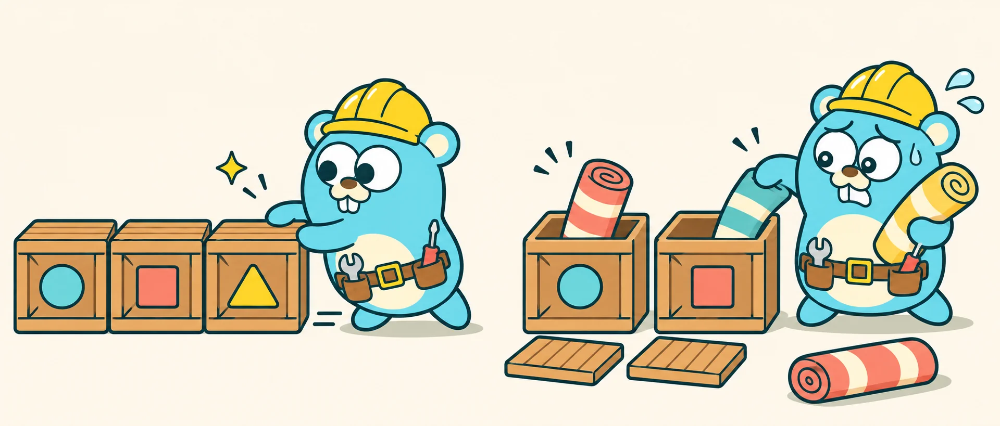

# 3.3 扩展方向与标准库

## 加一族容易，加一种产品难

抽象工厂有两个扩展方向，难度完全不同：

{ .illus }

加一套新风格只是多一只箱子；给每套都加一种新家具，就得拆开所有箱子

| 扩展 | 要做什么 | 旧代码 |
|---|---|---|
| 新增一族（如高对比主题） | 新写一个实现 `Theme` 的类型 | 一行不改 |
| 新增一种产品（如输入框） | `Theme` 加方法 `NewInput`，**每个**具体工厂都要实现 | 全部要改 |

新增产品时，漏实现的工厂会**编译失败**，不会漏掉；代价是改动面大。所以 ==接口里的产品种类要先想清楚，之后主要沿「加一族」的方向扩展==。

## 标准库中的抽象工厂

| 抽象工厂 | 产出的一族产品 | 保证了什么 |
|---|---|---|
| `driver.Conn`（`database/sql/driver`） | `Prepare` → `driver.Stmt`，`Begin` → `driver.Tx` | 语句和事务来自同一个驱动、同一条连接 |
| `embed.FS`、`fstest.MapFS`（`io/fs` 的实现） | `Open` → `fs.File`，`ReadDir` → `[]fs.DirEntry` | 文件和目录项来自同一个文件系统 |

每个数据库驱动（MySQL、PostgreSQL……）各实现一次 `driver.Conn`，`database/sql` 只认接口，换驱动时语句、事务整族一起换。

## 什么时候用

!!! success "适合"

    - 有多种对象必须**配套使用**：主题控件、数据库驱动、跨平台 UI
    - 需要整族切换：换主题、换数据库、测试时换成假对象
    - 产品种类基本稳定，主要增加新的「族」

!!! failure "不适合"

    - 只有一种产品（用工厂方法）
    - 产品种类经常增加，每次都要改所有工厂
    - 对象之间没有配套关系，混用也不会出错

