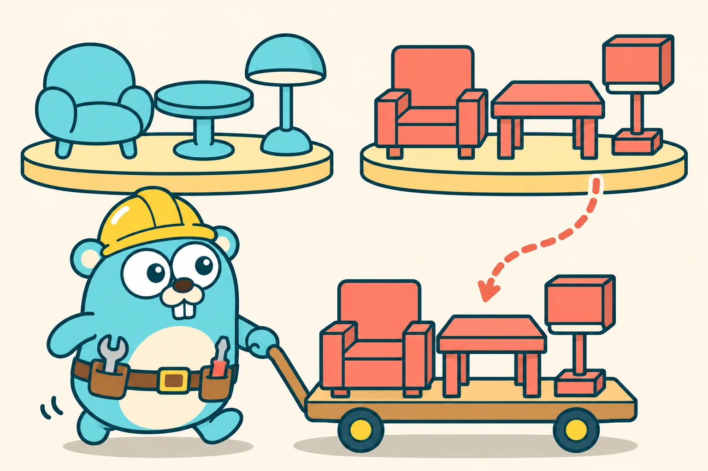

# 抽象工厂模式

:material-shape-outline: 创建型
:material-signal-cellular-2: 难度 进阶
:material-fire: 使用频率 中

{ .cover }

!!! abstract ""

    买家具时选定一套风格，桌、椅、灯整套配好，不会把圆润的椅子和方正的台灯摆在一起。

    抽象工厂模式用**一个工厂**创建**一整族配套的对象**；换工厂，整族一起换。

## 本章内容

| 节 | 内容 |
|---|---|
| [3.1 问题与思路](problem.md) | 各自创建为什么会混搭，一个工厂怎么保证配套 |
| [3.2 Go 实现](implementation.md) | 产品接口、工厂接口、具体工厂、调用方四步写完 |
| [3.3 扩展方向与标准库](extend.md) | 加一族容易、加一种产品难，标准库中的例子，什么时候用 |
| [3.4 小结](summary.md) | 重点回顾、常见问题与动手试试 |

**相关对比**：[创建对象](../../compare.md#creators)
