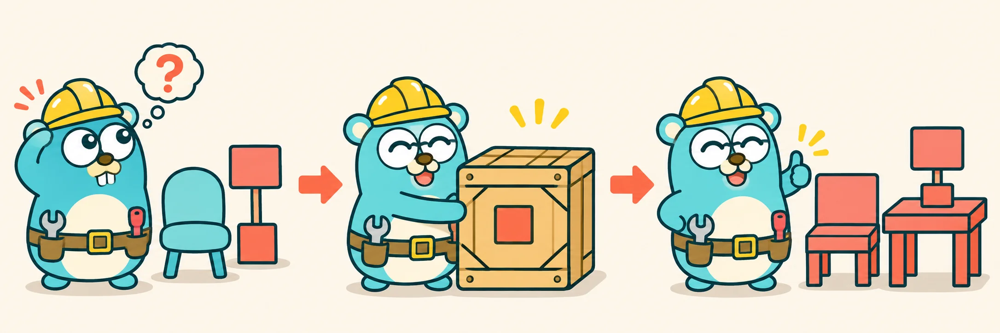
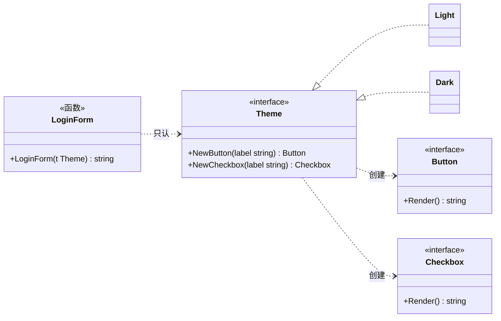

# 3.1 问题与思路

## 各自创建，容易混搭

登录页有勾选框和按钮，要支持浅色、深色两套主题。就像布置房间，家具要成套。

{ .illus }

<p class="caption">一件一件挑容易混搭；整套从一个箱子里出来，自然配套</p>

最直觉的写法是每个控件各自判断主题：

```go
--8<-- "codes/creational/abstractfactory/bad.go:bad"
```

| 痛点 | 后果 |
|---|---|
| 主题判断散落在每个控件 | 一处写错，页面上就出现混搭，编译器发现不了 |
| 新增一套主题 | 每个创建控件的地方都要加分支 |

根本原因：**「用哪一套」被每个控件各决定了一次**。

## 一个工厂负责一整套

把一套主题能创建的控件写成一个接口 `Theme`（抽象工厂），每种控件一个方法；每套主题实现一次，只生产自己那一族。页面只持有 `Theme`，所有控件都向它要。

==「用哪一套」只决定一次：选定工厂，之后拿到的每个对象都来自同一族==。



<p class="caption">Light、Dark 各实现一次 Theme，只创建自己那一族的控件；LoginForm 只认接口，拿到的控件必然同族</p>

| 角色 | 职责 | 本例中 |
|---|---|---|
| 抽象工厂（Abstract Factory） | 声明一族产品的创建方法 | `Theme` |
| 具体工厂 | 只创建某一族产品 | `Light`、`Dark` |
| 抽象产品 | 某一种产品的接口 | `Button`、`Checkbox` |
| 具体产品 | 某一族里的某一种产品 | `lightButton`、`darkCheckbox` 等 |
| 客户端（Client） | 只通过抽象工厂和抽象产品工作 | `LoginForm` |
