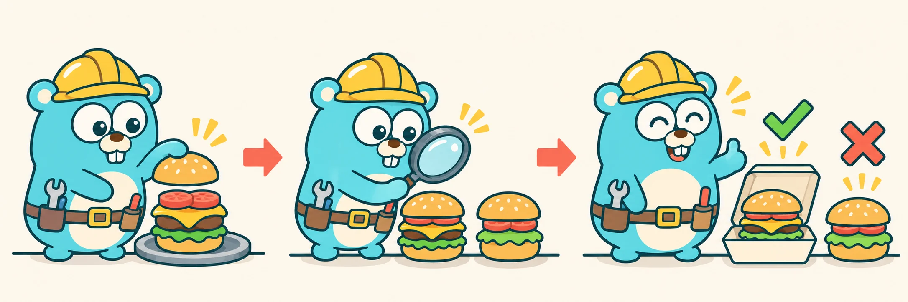

# 4.2 Go 实现

## 三步写完

**第 1 步**：产品。字段全部小写，包外无法直接用结构体字面量创建，只能走建造者。

```go
--8<-- "codes/creational/builder/server.go:product"
```

**第 2 步**：建造者。创建时只要必填项，其余参数由 `defaults` 填上默认值；每个设置方法改一项参数，并返回建造者自己，所以可以连着写（链式调用）。`Timeout`、`MaxConns` 写法相同，略。

```go
--8<-- "codes/creational/builder/builder.go:builder"
```

**第 3 步**：`Build`。所有检查都在这里做，包括参数之间的组合，例如「开启 TLS 却仍用 80 端口」。

{ .illus }

<p class="caption">出餐前统一检查：合格的才装盒送出，缺料的留在店里</p>

```go
--8<-- "codes/creational/builder/builder.go:build"
--8<-- "codes/creational/builder/server.go:validate"
```

!!! tip "设置方法里为什么不检查"

    链式调用的每一步都只能返回建造者，没有位置返回 `error`。所以设置方法只记录，检查统一留到 `Build`，错误只从这一处返回。

## 使用示例

```go
--8<-- "codes/creational/builder/example_test.go:example"
```

[:material-play: 在 Go Playground 运行](https://go.dev/play/p/TODO){ .md-button .md-button--primary target=_blank }
