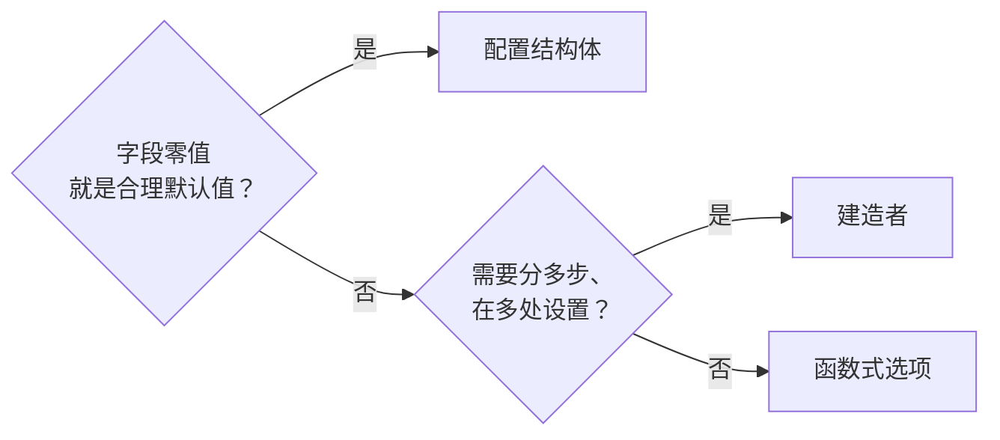

# 4.3 函数式选项与标准库

## Go 更常见的写法：函数式选项

Go 社区更常用**函数式选项（Functional Options）**：每个可选参数写成一个函数，构造函数用可变参数接收。`WithPort` 返回的函数会记住端口号（见[函数值与回调](../../appendix/callbacks.md)）。

```go
--8<-- "codes/creational/builder/options.go:options"
```

调用时写成 `NewServer("localhost", WithPort(8443), WithTLS())`。它和建造者共用同一套默认值与校验，思路相同：参数有名字、可省略、最后统一校验；区别是不需要单独的建造者类型。

## 三种写法怎么选

| 写法 | 调用样子 | 主要缺点 | 实例 |
|---|---|---|---|
| 配置结构体 | `http.Server{Addr: ":8080", ReadTimeout: 5 * time.Second}` | 分不清「填了零值」和「没填」，没有统一校验的时机 | `http.Server`、`tls.Config`（标准库） |
| 建造者 | `NewServerBuilder(addr).Port(8443).Build()` | 多一个类型，每个参数一个方法 | `strings.Builder`、`url.Values`（标准库） |
| 函数式选项 | `NewServer(addr, WithPort(8443))` | 每个参数一个函数，选项分散在文档各处 | `grpc.NewServer`（google.golang.org/grpc） |

`strings.Builder` 用 `WriteString` 一段段追加，最后 `String()` 一次取出结果；`url.Values` 用 `Add` 逐个添加参数，最后 `Encode()` 生成查询字符串。两者都是「分步构建、最后一次交付」。



<p class="caption">先看零值能不能直接用；需要分步构建时选建造者，否则函数式选项更简洁</p>

## 什么时候用

<div class="grid" markdown>

!!! success "适合"

    - 可选参数多，大多数调用只改其中几项
    - 参数之间有约束，需要创建前整体校验
    - 对象要分多步、在多处逐步组装（如拼接字符串、查询条件）

!!! failure "不适合"

    - 参数只有两三个，直接写构造函数更清楚
    - 字段零值就是合理默认值，用配置结构体即可
    - 对象创建后还要频繁修改（建造者只负责创建）

</div>
