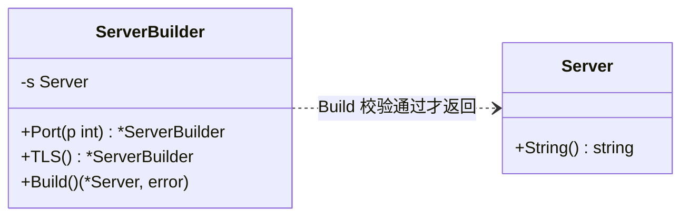

# 4.1 问题与思路

## 参数一长，调用就看不懂

创建一个服务器要设置地址、端口、超时、最大连接数、是否开启 TLS。就像做汉堡，配料一多，顺序就容易乱。

{ .illus }

<p class="caption">配料一次全倒下去容易乱；一层一层按单子放，最后得到的汉堡层次分明</p>

最直觉的写法是把所有参数都放进构造函数：

```go
--8<-- "codes/creational/builder/bad.go:bad"
```

| 痛点 | 后果 |
|---|---|
| 调用处只有一串值，没有名字 | 读不出 `100`、`8080` 各是什么 |
| 同类型的参数写反 | 编译器不报错，运行时才出问题 |
| 只想改一项，也得把所有参数写全 | 默认值散落在每个调用处 |
| 新增一个参数 | 所有调用处都要改 |

根本原因：**所有参数必须在一次调用里、按位置一次给全**。

## 分步设置，最后一次交付

1. 写一个建造者 `ServerBuilder`，先暂存参数；必填的地址在创建建造者时给出，其余先用默认值。
2. 每个参数一个设置方法，带着名字，只调用需要改的。
3. 最后调用 `Build`：整体校验，合格才创建 `Server`。

==每个参数都有名字、可以省略；对象在 Build 时一次创建，校验也集中在这一处==。



<p class="caption">设置方法返回建造者自己，所以能连着写；只有 Build 校验通过，调用方才拿到 Server</p>

| 角色 | 职责 | 本例中 |
|---|---|---|
| 建造者（Builder） | 暂存参数，提供设置方法和 Build | `ServerBuilder` |
| 产品（Product） | 最终要创建的复杂对象 | `Server` |
| 客户端（Client） | 按需调用设置方法，最后 Build | 调用方 |
| 指挥者（Director） | 按固定顺序调用建造步骤 | 本例省略，见 [4.4](summary.md) |

说白了，Go 里先试最简单的：**传一个配置结构体**，像标准库的 `http.Server{Addr: ":8080"}`：字段带名字、没写的取零值。零值不是合理默认值、或需要创建前统一校验时，再用函数式选项或建造者，取舍见 [4.3](options.md)。
