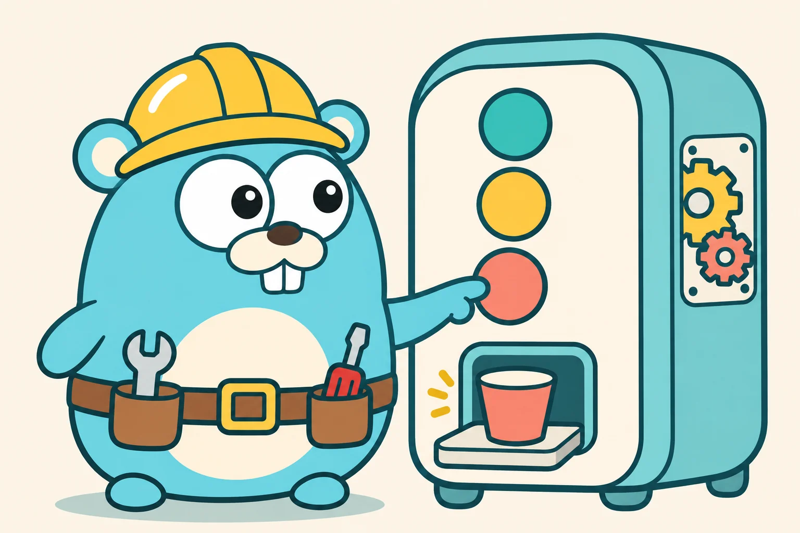

# 工厂方法模式

:material-shape-outline: 创建型
:material-signal-cellular-1: 难度 入门
:material-fire: 使用频率 高

{ .cover }

!!! abstract ""

    在自动售货机前，只需按下想要的那款饮料；饮料怎么做，是机器自己的事。

    工厂方法模式把「创建哪个类型」交给一个**专门的函数**，调用方只说**要什么**，拿到的是**接口**。

## 本章内容

| 节 | 内容 |
|---|---|
| [2.1 问题与思路](problem.md) | 到处 `new` 具体类型有什么问题，工厂函数怎么解决 |
| [2.2 Go 实现](implementation.md) | 产品接口、工厂函数、调用方三步写完 |
| [2.3 注册表与标准库](registry.md) | 新增类型不改工厂、标准库中的例子、什么时候用 |
| [2.4 小结](summary.md) | 重点回顾与常见问题 |
